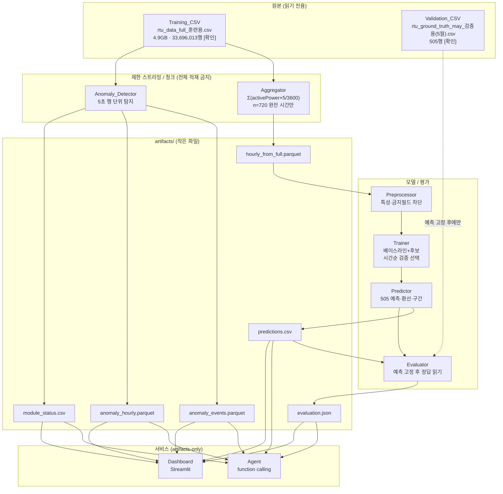

# Design Document

## 사실 라벨링 규약 (requirements.md와 동일)

- **[확인]**: 프롬프트 1 "작업 1" 사전 점검에서 안전한 메타데이터·헤더·샘플·순차 행 수 확인으로 검증된 사실.
- **[미확인]**: 전수 검증을 하지 못해 사실로 확정할 수 없는 항목.
- **[추정]**: 샘플·간접 근거에 기반한 추측으로 전수 확인되지 않은 항목.
- **[결정 필요]**: 사용자 판단·승인이 필요한 항목. 승인 전에는 구현·평가 기준으로 확정하지 않는다.

> 본 설계 문서는 Requirements-First 워크플로의 **Design 단계** 산출물이다. 요구사항(requirements.md)을 변경하지 않는다. 미결정 중 일부는 사용자 승인으로 **결정 완료**되었다: **O-9=(a) 3상 동시 판정**, **O-5=설비 최대 13 상한+발견 집합**, **O-7=분위수 잠정값(0.05/0.95)**, **O-10=MAE 73/89 참고용만(합격 기준 아님)**. 나머지(O-1·O-2·O-3·O-4·O-6·O-8)는 `[결정 필요]`로 유지한다. PDF 3개 본문은 여전히 **[미확인]**이다.

---

## Overview

Factory Energy Copilot는 공장 5초 원본 전력 데이터로부터 (1) 2025년 5월 공장 전체 시간별 전력량을 예측하고, (2) 전기요금·탄소배출로 환산하며, (3) 5초 원본의 이상 구간을 머신러닝 기법으로 탐지하고, (4) OpenAI API 기반 에이전트와 Streamlit 대시보드로 **근거 기반** 결과를 전달하는 시스템이다. 설계 목표는 요구사항(REQ-GOAL, A/B/C/D, S1~S7)을 **artifacts만을 유일한 서비스 데이터 소스**로 하는 구성요소 분리 아키텍처로 실현하는 것이다 [확인: requirements.md REQ-PROB, REQ-GOAL].

핵심 설계 원칙:

- **원본 불변·대용량 안전 처리:** 4.9GB Training_CSV(`data/rtu_data_full_훈련용.csv`, 헤더 제외 물리 행 33,696,013개 [확인])는 전체 메모리 적재 없이 StreamReader 순차 또는 제한 청크로만 처리한다 (R1, R13, NFR-1).
- **train/validation 완전 분리:** Validation_CSV(`data/rtu_ground_truth_may_검증용(5월).csv`, 505행 [확인])는 예측 고정 후 Evaluator만 읽는다 (R5, R12, NFR-4).
- **계산은 Python, 서술은 LLM:** 모든 수치는 Python이 artifacts로 계산하고 LLM은 숫자를 계산하지 않는다 (R10).
- **단정 금지:** "고장" 대신 "이상 구간/이상 징후"로 표현한다 (R9).

### 시스템 경계 (System Boundary)

| 경계 | 포함 (In) | 제외 (Out) |
|---|---|---|
| 데이터 입력 | Training_CSV(읽기 전용), Validation_CSV(평가 전용) | 실시간 스트림, 외부 센서 연동 |
| 계산 | 집계·학습·예측·평가·이상탐지 (Python) | LLM 수치 계산 |
| 서비스 | artifacts 기반 Agent·Dashboard | 원본 CSV 직접 조회 |

### 비목표 (Non-Goals)

다음은 설계 범위에서 **확정 제외**한다 (REQ-NONSCOPE [확인]):

- 실시간 연동, 설비 제어, 고장 확정 진단, 생산량 대비 효율, 전년 대비 비교, 점검 이력 관리.

다음은 **[결정 필요]**로 유지한다 (REQ-OPEN O-1):

- PDF 3개 본문 미확인 → PDF 내보내기 등 PDF 기인 범위·비목표는 원문 확인·사용자 승인 전까지 확정하지 않는다 [결정 필요].

---

## Architecture

> 구성요소별 상세 책임·입출력·인터페이스(함수 schema, UI 계약, 저장소 계약)는 아래 **Components and Interfaces** 섹션에 모았다. 각 산출물(artifact)의 필드·타입·형식 스키마는 **Data Models** 섹션에 모았다.

## Components and Interfaces

### 구성요소 책임과 입출력 (R6 역할 분리: aggregate/train/predict/evaluate/anomaly/agent/app)

| 구성요소 | 책임 | 입력 | 출력 | 관련 요구사항 |
|---|---|---|---|---|
| **Aggregator** (aggregate) | 5초 원본을 시간·설비별로 집계. Σ(activePower×5/3600) 계산, n=720 완전 시간 판별 | Training_CSV (제한 스트리밍) | `artifacts/hourly_from_full.parquet` | A1, NFR-1, NFR-2 |
| **Preprocessor** (전처리 유틸) | 각 기능이 **필요에 맞게 호출**하는 공용 전처리 라이브러리(공장 전체 시간별 전력량 생성, 달력 특성 생성, 금지 특성 차단). 전역 공유 산출물을 강제하지 않고, 호출 기능이 자신에게 필요한 전처리만 수행한다 [확인: 팀장 피드백] | hourly_from_full.parquet 등 각 기능 입력 | 호출 기능별 특성 테이블(artifacts, 선택적) | A1, A3, NFR-4 |
| **Trainer** (train) | 베이스라인 3종 + 선형회귀 + 트리모델 학습, 시간순 검증 MAE로 선택, 전체 재학습 | 특성 테이블(artifacts) | 선택 모델·파라미터·검증 비교(artifacts) | A2, A3, A4 |
| **Predictor** (predict) | 확정 모델로 505개 시점 예측, 요금·탄소 환산, 예측구간 생성 | 선택 모델, config | `artifacts/predictions.csv` | A5, A8, NFR-8 |
| **Evaluator** (evaluate) | 예측 고정 후 Validation_CSV를 읽어 MAE·총합오차·비교표 계산 | predictions.csv, Validation_CSV | `artifacts/evaluation.json` | A6, A7, NFR-4, S2 |
| **Anomaly_Detector** (anomaly) | 5초 행 단위 규칙·통계·비지도 탐지, 방법 비교, 설비 상태 산출 | Training_CSV (제한 스트리밍) | `anomaly_events.parquet`, `anomaly_hourly.parquet`, `module_status.csv` | B1~B6 |
| **Agent** (agent) | OpenAI function calling, artifacts-only 도구 호출, fallback·캐시 | artifacts, OPENAI_API_KEY | 브리핑·질의응답 텍스트 | C1~C5, NFR-6 |
| **Dashboard** (app) | Streamlit 탭·필터·상태색·그래프·경고·계산식 | artifacts | 화면 | D1~D7 |
| **Artifacts 저장소** | 작은 파일(CSV/Parquet/JSON) 보관. 서비스의 유일한 데이터 소스 | 상위 구성요소 출력 | Agent·Dashboard 입력 | R2, REQ-DATA |

### 데이터 흐름 다이어그램



### 누수 방지 경계 (요약 — 상세는 아래 전용 절)

위 흐름에서 `VAL`은 점선으로 표기했으며 **Evaluator만** 예측 고정 후 접근한다. Trainer·Predictor·Anomaly_Detector·Preprocessor는 Validation_CSV 경로를 참조하지 않는다 (NFR-4, S2).

---

## 대용량 데이터 처리 설계 (NFR-1, NFR-2, A1)

### 스트리밍 전략

- **금지:** PowerShell `Get-Content` 전체 로드, `Import-Csv` 전체 로드, pandas `read_csv` 전체 로드, 에디터 열기 (R1, R13, NFR-1).
- **허용:** `StreamReader` 순차 1회 스캔 또는 제한된 청크(chunk) 처리. 집계·이상탐지는 한 번의 순차 패스로 설계해 재스캔을 최소화한다.
- **청크 경계:** 한 청크를 처리한 뒤 원본 행 버퍼를 해제하고 다음 청크로 넘어간다. 동시에 보유하는 행 수의 상한을 설정값으로 둔다. 메모리 상한을 넘길 가능성이 있으면 작업을 중단하고 방법을 재설계한다 (R13).
- **로그:** 청크 크기, 처리한 행 수, 메모리 사용량(피크), 처리 시간, 오류를 실행 로그에 남긴다 (NFR-1, NFR-7).

> **구현 상세(청크 크기·엔진 선택: StreamReader vs DuckDB vs pandas chunksize)는 Tasks 단계에서 확정한다 [결정 필요 아님, 설계 범위 외 세부].** 본 설계는 "전체 적재 없음 + 순차/제한 청크 + 로그"라는 계약만 고정한다.

### 원본 불변 검사 (NFR-2, R14)

- 각 처리 작업 **전후**로 두 CSV의 `Length`와 `LastWriteTime`을 비교한다. 가능하면 파일 해시도 비교한다.
- 전후 값이 다르면 작업을 실패로 처리하고 산출물을 무효화한다.
- 산출물은 `artifacts/` 아래에만 저장하며 원본·중간 산출물을 덮어쓰지 않는다.
- 기준값: Training_CSV `Length=4,909,245,995`, Validation_CSV `Length=46,000` (프롬프트 1 작업 1 기록 [확인]). 본 설계 단계에서는 재측정하지 않으므로 재측정 결과는 **[미검증]**이다.

### 집계 규칙 (A1, R4, F2)

- **시간별 전력량:** `hourly_pow(module, hour) = Σ(activePower × 5/3600)` — 해당 시간·설비의 5초 행에 대해 합산 (R4). 샘플에서 energy_Wh와 소수 4자리까지 일치 확인 [확인: F2].
- **공장 전체값:** 시간별로 전체 설비를 합산한다. 설비 수는 **최대 13 상한(O-5 결정)** 안에서 데이터에서 발견된 설비만 합산하며, 발견 수가 13과 다르면 경고로 기록한다(13 하드코딩 반복 금지).
- **완전 시간 판별:** `n=720`(시간당 5초 간격 720행)인 시간만 학습 입력으로 사용하고, 불완전 시간은 제외하며 **제외 건수를 로그에 기록**한다 (A1). F1의 "n=720이 46,800행, 마지막 시각만 n=1"은 rtu_hourly.csv 기준 [확인(샘플 집계본)]이며 원본 전수는 [미확인].
- 산출물: `artifacts/hourly_from_full.parquet`.

---

## 누수 방지 경계 (NFR-4, A4, A5, S2)

### 경로·변수·산출물·로그 분리

| 분리 축 | 학습 측 | 검증 측 |
|---|---|---|
| 경로 | `data/rtu_data_full_훈련용.csv` | `data/rtu_ground_truth_may_검증용(5월).csv` |
| 변수/모듈 | aggregate / preprocess / train / predict | evaluate 전용 |
| 산출물 | hourly_from_full.parquet, predictions.csv, 모델 | evaluation.json |
| 로그 | 학습·예측 로그 | 평가 로그(별도 네임스페이스) |

### 자동 검사 위치

1. **경로 참조 검사:** aggregate/preprocess/train/predict 모듈이 Validation_CSV 경로 문자열을 참조하지 않음을 정적 검사·테스트로 확인한다 (S2, NFR-4). → Tasks 단계에서 테스트로 고정.
2. **흐름 고정:** Evaluator는 `predictions.csv`가 **고정(생성 완료·불변)된 뒤에만** Validation_CSV를 읽는다. Predictor 단계에서는 정답을 읽을 수 없도록 호출 순서를 데이터 흐름으로 강제한다 (A4, A5).
3. **보정 금지:** 정답으로 예측을 보정하는 코드 경로가 없어야 한다 (A7, R5).

> **검사 구현(정적 스캔 도구·테스트 케이스)은 Tasks 단계 [승인 후 작성].** 본 설계는 "분리 축 + 검사 위치"를 계약으로 고정한다.

---

## 예측 설계 (A2~A8, NFR-8)

### 베이스라인 3종 (A2)

1. **전체 평균 반복:** 학습 전체 평균을 모든 505시점에 반복.
2. **요일·시간대 과거 평균:** 같은 요일·같은 시간대의 과거 평균.
3. **직전 주 같은 시간:** 예측 시점의 직전 주 같은 시간 값. (단, 학습 종료 4/30과 예측 시작 5/10 사이 간격으로 인한 lag 가용성은 특성 경계 규칙을 따른다.)

세 베이스라인의 모델명과 시간순 평가 MAE를 비교표에 기록한다 (A2).

### 후보 모델과 선택 (A3, A4)

- **후보 순서:** 달력 특성(요일·시간대·주차 등) 선형회귀 → 트리 모델 1종.
- **금지 특성 경계 (A3):**
  - 5월에 알 수 없는 전압·전류·역률(voltage*, current*, powerFactor*)을 예측 입력 특성으로 쓰지 않는다.
  - 학습 종료 4/30 ~ 예측 시작 5/10 사이의 최근값(lag)을 특성으로 쓰지 않는다.
  - 특성 목록에 금지 필드가 없음을 설정·코드 검사로 확인한다.
- **모델 선택 (A4):** 학습 구간 **마지막 3주를 검증 구간**으로 한 **시간순 검증 MAE만** 사용. 5월 정답은 선택에 참조하지 않는다. 선택 확정 후 **전체 기간으로 재학습**해 5월을 예측한다. 분할 시각·선택 점수·재학습 시점을 로그·비교표에 남긴다.

### 산출물 스키마

> 필드·타입 스키마의 단일 출처는 **Data Models** 섹션이다. 아래는 예측 로직 관점의 요약이며, 상세 스키마는 Data Models의 `predictions.csv`·`evaluation.json` 표를 참조한다.

**`artifacts/predictions.csv`** (A5, A8):

| 필드 | 설명 | 규칙 |
|---|---|---|
| `id` | 시각 | 2025-05-10 00:00 ~ 2025-05-31 00:00, 1시간 간격, 505행, Validation_CSV id와 1:1 |
| `pred_pow` | 예측 전력량 | hourly_pow 척도 |
| `pred_bill` | 예측 요금 | `pred_pow × 180` (config) |
| `pred_carbon` | 예측 탄소 | `pred_pow × 0.424` (config) |
| `pred_low` | 예측 하한 | 검증 구간 잔차 분위수 기반 [A8], 분위수 **잠정 0.05 (O-7, config 상수, "임시" 표시)** |
| `pred_high` | 예측 상한 | 각 행에서 `pred_low ≤ pred_pow ≤ pred_high` |

**`artifacts/evaluation.json`** (A6):

- `mae_hourly_pow`, `mae_may_bill`, `mae_may_carbon` 각각 **504 기준(마지막 2025-05-31 00:00 제외)과 505 기준 둘 다** (R7).
- `agg_pow_total_error`: agg_pow 대비 예측 총합 오차.
- `baseline_comparison`: 베이스라인 3종 + 후보 모델의 시간순 MAE 비교표.

### 환산식 (NFR-8, R8)

- `may_bill = hourly_pow × 180`, `may_carbon = hourly_pow × 0.424` — 정답 파일과 동일 척도(1000으로 나누지 않음).
- 환산 계수는 **config 한 곳**에만 두고 화면에 계산식을 표기한다.

### 해석 참고값 (A7, O-10 [결정됨 — 참고용만])

- 학습 평균 반복 MAE 약 89, 하한 약 73은 **참고용으로만** evaluation·로그에 기록한다(사용자 승인).
- 73/89를 **경고 임계값·합격/불합격 기준으로 사용하지 않는다**. 실제 시간순 검증 MAE와 산출식·출처를 함께 보고한다.
- 정답으로 예측을 보정하는 코드는 없다 (R5).

---

## 이상탐지 설계 (B1~B6)

### 탐지 단위 (B1)

- 탐지 단위는 **5초 행(module/localtime)**. 시간별 전력량 기준 탐지는 주 방법으로 사용하지 않으며, hourly 결과는 집계 결과로만 표시한다.

### 세 방법의 책임 경계 (B2)

| 방법 | 책임 | 학습/점수화 |
|---|---|---|
| **규칙** | **(a) 3상 동시** 판정으로 후보 추출 (O-9 결정) | 임계값 210V·85% config 상수 (아래 참조) |
| **통계** | 설비별 3σ 또는 robust z-score | 설비별 분포 기반, 전체 적재 없이 통계량 스트리밍 산출 |
| **비지도** | Isolation Forest 등 | **표본 학습 후 청크 점수화** (전체 적재 금지, 2-Pass) |

- **후보 특성:** 3상 전압 평균, 3상 역률 평균, 3상 전류 평균, activePower, `activePower / Σ(V×I×PF/100)` 비율.
- 세 방법은 **같은 대상(5초 행)**에 적용하고 결과를 매칭한다.
- **패스 수 명시(검토 반영):** 설계 원칙은 "전체 메모리 적재 금지 + 순차/제한 청크"이며 **1-Pass를 강제하지 않는다**(여러 번 순차 스캔 허용). 비지도 모델은 (1) **1차 순차 스캔에서 Reservoir Sampling(고정 크기 표본, 예: 10만 행)** 으로 표본을 메모리 상한 내로 유지해 학습하고, (2) **2차 순차 스캔에서 각 5초 행을 점수화**한다. 즉 비지도 경로는 명시적으로 **2-Pass**다. 통계(3σ/robust z)는 1차 스캔에서 설비별 통계량을 함께 산출할 수 있다. 알고리즘 교체(`partial_fit` 계열)는 현재 결정(Isolation Forest)을 유지하므로 도입하지 않는다.
- **I/O 참고(1-Pass 통합 보류):** Aggregator와 Anomaly_Detector가 원본을 각각 스캔하므로 집계·이상탐지 전체로는 디스크 I/O가 여러 패스다. 현재 구현은 행 단위 스트리밍이라 메모리는 상수에 가깝고 스파이크 위험이 낮다. 단일 리더로 두 소비자에 청크를 브로드캐스팅하는 통합(Chunk Coordinator)은 모듈 책임을 묶고 복잡도를 올리므로 **지금은 도입하지 않는다**. 성능이 실제 병목으로 확인되면, 집계 패스에서 이상탐지용 보조 통계를 함께 산출하는 방식을 우선 검토한다.

### 규칙 판정식 (O-9 [결정됨] — (a) 3상 동시 채택)

F5에서 확인된 현상(3상 동시 이상 [확인: F5])에 따라, 사용자 승인으로 **(a) 3상 동시 판정**을 확정 판정식으로 채택한다:

```
(voltageR<210 AND voltageS<210 AND voltageT<210)
OR
(powerFactorR<85 AND powerFactorS<85 AND powerFactorT<85)
```

| 해석 | 판정식 | 상태 |
|---|---|---|
| **(a) 3상 동시** | 세 상이 모두 임계값 미만일 때만 후보 | **채택 (F5 동시 하락 관측과 일치)** |
| (b) 상별 | 한 상이라도 임계값을 넘으면 후보 | 미채택(허위 양성 과다) |

- 임계값(전압 210V, 역률 85%)은 **config 단일 상수**로 둔다. 다른 기능·테스트는 이 상수를 참조한다.
- 새 이상 유형은 관측 근거·필드·판정식·임계값·승인 주체를 먼저 문서화하고 승인 전에는 구현·평가에 추가하지 않는다 (B2).

### 방법 비교와 평가 편향 방지 (B3, O-4 [결정 필요])

- 방법별 탐지 건수와 방법 간 겹침을 표로 만든다.
- **독립 정답 라벨이 없는 동안 규칙 결과를 "정답"으로 부르지 않는다.** 규칙 기준 계산값은 `규칙 대비 일치율`·`규칙 포착률` 같은 **프록시**로 명명하고 분모·대상 기간·규칙 한계를 함께 표시한다.
- 독립 라벨 확보(출처·생성 시점·학습/튜닝 분리·평가 전용)는 `[결정 필요 O-4]`로 제시해 승인받는다.

### 산출물 스키마 (B4)

> 필드·타입 스키마의 단일 출처는 **Data Models** 섹션이다. 아래는 이상탐지 관점의 요약이며, 상세 스키마는 Data Models의 `anomaly_events.parquet`·`anomaly_hourly.parquet`·`module_status.csv` 표를 참조한다.

**`artifacts/anomaly_events.parquet`**: `module`, `localtime`, `type`(유형), `value`(값), `normal_range`(정상범위), `detected_by`(방법별 탐지 여부), `score`(점수).

**`artifacts/anomaly_hourly.parquet`**: `hour`, `module`, `type`별 `count`(건수).

**`artifacts/module_status.csv`**: `module`, `anomaly_count`(이상 건수), `anomaly_ratio`(비율), `last_seen`(최근 발생 시각), `status`(정상/주의/이상).

- 원본은 산출물로 덮어쓰지 않는다 (NFR-2).

### 상태 분류 (B5, O-3 [결정 필요])

- 상태 정상/주의/이상은 **설비별 이상 행 비율**과 **평소 시간당 건수 대비 급증 여부**로 정한다.
- 해당 설비는 거의 매 시간 이상 행이 있으므로(F5), 이상이 있었던 "시간 수"만으로 구분하지 않는다.
- **경계값·급증 정의는 임의로 확정하지 않고 `[결정 필요 O-3]`로 둔다.** 승인 전에는 module_status의 status를 미확정 라벨로 표시한다.

### 영향·잡음 판정 (B6, O-2 [결정 필요])

- 이상 구간의 전력량·요금 영향은 **측정된 경우에만** 표시하고, 잡음 범위면 `영향 없음(잡음 범위)`로 기록한다.
- 미측정 값을 숫자로 표시하지 않는다. 영향 정의·"잡음 범위" 판정 기준은 `[결정 필요 O-2]`. F5의 "시간별 전력량에 삽입 이상치 미관측(편차 3.9%, 정규 잡음 범위)"은 샘플 근거 [확인: F5]이나 전수는 [미확인].

### 설비 수 (O-5 [결정됨 — 최대 13 상한 + 발견 집합])

- **O-5 결정:** 설비 수 **최대 13을 상한/기대값**으로 두고, module_status는 **실제 집계에서 발견된 설비만** 표시한다. 발견 수가 13과 다르면 경고·안내로 남긴다. 13을 하드코딩해 없는 설비까지 반복하지 않는다 (D3, O-5).

---

## Components and Interfaces (계속) — Agent·Dashboard·저장소 인터페이스

> Overview·Architecture 다음에 둔 **Components and Interfaces** 섹션의 연속이다. 아래 세 절(Agent API 계약, Dashboard UI 계약, 저장소/파일 계약)은 구성요소의 외부 인터페이스를 정의한다. 각 artifact의 필드·타입 스키마는 **Data Models** 섹션을 참조한다.

### API 계약 (Agent) — C1~C5, NFR-6

#### Function Schema (artifacts-only)

모든 함수는 `artifacts/` 아래 파일만 읽는다. 숫자는 artifacts에서만 가져오며 LLM은 계산하지 않는다 (C2, R10).

| 함수 | 입력 | 출력(요약) | 읽는 artifact |
|---|---|---|---|
| `get_forecast_summary(start, end)` | 기간 | 전력·요금·탄소 합/평균, 기간 메타 | predictions.csv |
| `get_evaluation()` | 없음 | MAE(504/505), 총합오차, 비교표 | evaluation.json |
| `get_module_status()` | 없음 | 설비별 상태·비율·최근 시각 | module_status.csv |
| `get_anomaly_events(module, start, end, type)` | 필터 | 이벤트 목록(값·정상범위·방법·점수) | anomaly_events.parquet |
| `get_anomaly_trend(module, freq)` | 설비·주기 | 시간/주기별 이상 건수 추세 | anomaly_hourly.parquet |

- 각 함수는 **입력 스키마·출력 스키마·허용 경로·오류 응답**을 문서화한다 (C1).
- **경로 제약:** artifacts 루트 밖(원본 CSV 포함) 접근 시 오류를 반환한다. artifacts 밖 접근 거부를 테스트로 확인한다 (C1).

#### 응답 규칙 (C2~C4)

- 결과에 없는 내용은 `데이터에 없음`으로 답한다 (C2).
- 기간 브리핑(전력·요금·탄소·MAE·주의 설비·확인 항목·분석 한계), 자연어 질의응답, **대상별 전환**(경영진 5줄 이내 / 에너지 관리자 / 현장 담당자)을 제공한다 (C3).
- `고장`·`위험 확정` 같은 단정을 사용하지 않고 **관찰된 사실 / 가능한 원인 후보 / 현장 확인 항목** 세 구획으로 구분한다 (C4, R9).

#### Fallback·캐시·키 관리 (C5, NFR-6)

- `OPENAI_API_KEY`가 없거나 API 호출이 실패하면 **예외 없이** 규칙 기반 요약으로 대체하고, 호출 결과를 캐시한다 (C5).
- 키·모델명은 환경변수/시크릿에서만 읽는다: `OPENAI_API_KEY`, `OPENAI_MODEL`(변경 가능). 값·부분값·환경 덤프를 코드·로그·문서·화면에 남기지 않는다 (R11, R16, NFR-6).

---

### UI 계약 (Dashboard) — D1~D7

- **artifacts만 읽는다** (원본 CSV 미접근, S7).

| 영역 | 내용 | 요구사항 |
|---|---|---|
| 헤더 | 팀명 `문학적인 기계`, 제목 `Factory Energy Copilot`, 한 줄 설명, 데이터 기준 기간 | D1 |
| 예측 탭 | 시간대별 요금·탄소 예측, 실제값·예측값·예측구간 그래프, 전력량/요금/탄소 MAE 카드, 베이스라인 비교표, 총 전력량·요금·탄소, **계산식 표기** | D2, S3 |
| 이상 탭 | 설비 상태표(정상/주의/이상 **색**), 이벤트 표, 선택 설비 전압·역률 시계열 이상 지점, 세 방법 비교표 | D3 |
| AI 탭 | 브리핑 생성, 대상별 보고서 전환, 질의 입력. **계산 결과와 AI 문장 구분** | D4 |
| 사이드바 | 날짜 필터, 설비 필터 (결과 표·그래프·도구 질의 범위에 적용) | D5 |
| 경고 | 실제값이 예측구간을 벗어난 시간, 시간당 이상 건수 급증 설비 (근거 수치·데이터 없음 상태 구분) | D6 |

- **설비 수 [O-5 결정]:** 상태표는 최대 13 상한 안에서 집계에서 발견된 설비만 표시하고, 발견 수가 13과 다르면 화면에 안내를 둔다 (D3).
- **첫 화면 성능 [결정 필요 O-6]:** `5초` 목표는 근거·측정 환경·측정 명령·허용 오차가 승인된 경우에만 acceptance로 사용한다. 승인 전에는 측정값을 기록하되 **합격/실패로 판정하지 않는다** (D7, NFR-5).
- **역할 페르소나 표시(REQ-USER) [확인: 팀장 피드백 "역할명으로만"]:** 역할 기반 맞춤 화면은 **역할명(설비 관리 담당자 / 에너지 관리 담당자)으로만** 표시하고 개인 이름을 부여하거나 이름 단위로 조회하지 않는다. 역할 전환·필터링 틀은 `role` 식별자(enum: `facility`=설비 관리 담당자, `energy`=에너지 관리 담당자)만을 분기 기준으로 사용하고, 역할별로 기본 탭·우선 노출 지표를 다르게 보여준다. 이름/개인정보 필드는 UI·도구·로그 어디에도 두지 않는다(NFR-6). 역할 enum은 추후 역할 추가에 대비해 config/상수로 단일 정의한다.

---

### 저장소/파일 계약 (R2, R14, NFR-6)

> 아래 표는 각 artifact의 **형식·생산자·소비자**(흐름 계약)만 정리한다. 각 artifact의 **필드·타입 스키마**는 **Data Models** 섹션에 모아 두었다.

| artifact | 형식 | 생산자 | 소비자 |
|---|---|---|---|
| `artifacts/hourly_from_full.parquet` | Parquet | Aggregator | Preprocessor, Dashboard |
| `artifacts/preprocessor_state.json` | JSON | Trainer(전처리 확정 시) | **Predictor(필수 로드)**, Evaluator |
| `artifacts/model.joblib` | joblib | Trainer | Predictor |
| `artifacts/predictions.csv` | CSV | Predictor | Evaluator, Agent, Dashboard |
| `artifacts/evaluation.json` | JSON | Evaluator | Agent, Dashboard |
| `artifacts/anomaly_events.parquet` | Parquet | Anomaly_Detector | Agent, Dashboard |
| `artifacts/anomaly_hourly.parquet` | Parquet | Anomaly_Detector | Agent, Dashboard |
| `artifacts/module_status.csv` | CSV | Anomaly_Detector | Agent, Dashboard |

- **경로·필드·형식**은 위 표로 고정한다. 각 artifact에 **버전/실행 메타**(생성 시각, 코드/설정 버전, 입력 경로)를 함께 기록한다 (NFR-7).
- **전처리 산출물은 공유 필수가 아니다 [확인: 팀장 피드백]:** 위 표의 서비스 artifact(hourly·predictions·evaluation·anomaly·module_status)는 Agent·Dashboard의 **공유 계약**이다. 기능 내부 전처리 중간 산출물(기능별 특성 테이블 등)은 각 기능이 필요에 맞게 만들며 다른 기능이 의존하도록 강제하지 않는다.
- **단, 학습→예측 전처리 상태는 반드시 공유한다(검토 반영):** 학습과 예측은 **같은 전처리 기준**(특성 컬럼 리스트·순서, 범주 인코딩 매핑, 결측 대체값, 필요한 경우 스케일링 계수)을 써야 모델 입력이 어긋나지 않는다. 따라서 Trainer는 전처리를 확정할 때 `artifacts/preprocessor_state.json`을 저장하고, **Predictor와 Evaluator는 이 파일을 로드해 동일 변환을 적용**한다(의존성 고정). 상태는 피클이 아닌 **JSON 메타**로 저장하고(버전 호환·보안), 모델 객체는 `artifacts/model.joblib`로 분리 저장한다. 이는 "기능별 자유 전처리"의 예외가 아니라, train/predict 쌍에 한해 재현성을 위해 상태를 명시적으로 전달하는 계약이다.
- **원본 불변:** 산출물은 `artifacts/` 아래에만 저장하고 원본·중간 산출물을 덮어쓰지 않는다 (R14, NFR-2).
- **배포 제외:** 배포 대상에 `data/`, `.env`, API 키를 포함하지 않는다. `data/`와 `.env`는 `.gitignore`에 둔다 (R1, R2, R16).

---

## Data Models

> 본 섹션은 서비스 산출물(artifacts)의 **필드·타입·형식 스키마**를 한곳에 모은다. 예측 설계·이상탐지 설계·저장소/파일 계약 절은 이 스키마를 **참조**하며, 스키마의 단일 출처(single source of truth)는 본 섹션이다. 모든 artifact에는 **버전/실행 메타**(생성 시각, 코드/설정 버전, 입력 경로)를 함께 기록한다 (NFR-7).

### hourly_from_full.parquet (Aggregator 산출) — A1, R4, F2

시간·설비별 집계 결과. `hourly_pow(module, hour) = Σ(activePower × 5/3600)`.

| 필드 | 타입 | 설명 | 규칙 |
|---|---|---|---|
| `module` | string | 설비 식별자 | 최대 13 상한(O-5 결정) 안에서 발견된 설비만. 발견 수가 13과 다르면 경고 |
| `hour` | datetime(KST) | 시간 버킷 | localtime(KST) 기준, timestamp 미사용 (NFR-3) |
| `hourly_pow` | float | 시간별 전력량 | Σ(activePower × 5/3600) |
| `n` | int | 해당 시간·설비의 5초 행 수 | 학습 입력은 `n=720`(완전 시간)만 사용, 그 외 제외·제외 건수 로그 (A1) |

### preprocessor_state.json (Trainer 산출, Predictor/Evaluator 필수 로드) — 재현성/누수 방지 (검토 반영)

학습 시점의 전처리 기준을 고정해 예측 시점에 동일하게 재현한다. JSON 메타로 저장(피클 미사용).

| 필드 | 타입 | 설명 |
|---|---|---|
| `feature_columns` | list[str] | 학습에 사용한 특성 컬럼 **이름·순서** (예측 입력도 동일 순서로 정렬) |
| `categorical_maps` | object | 범주형(요일 등) 인코딩 매핑. 미지 범주 처리 규칙 포함 |
| `missing_fill` | object | 특성별 결측 대체 기준값(학습 데이터 기준) |
| `scaling` | object/null | 스케일링을 쓰는 경우 특성별 mean/std 등. 트리 모델 등 불필요 시 null |
| `target_name` | string | 타깃 컬럼명(`target_hourly_pow`) |
| `model_path` | string | 연결된 모델 파일 경로(`artifacts/model.joblib`) |
| `code_config_version` | object | 코드/설정 버전, 생성 시각, 입력 경로, 난수 시드 (NFR-7) |

- Predictor는 이 파일을 로드하지 못하면 예측을 **실패 처리**한다(임의 재구성 금지). Validation_CSV는 참조하지 않는다(NFR-4).

### predictions.csv (Predictor 산출) — A5, A8, NFR-8

| 필드 | 타입 | 설명 | 규칙 |
|---|---|---|---|
| `id` | datetime(KST) | 시각 | 2025-05-10 00:00 ~ 2025-05-31 00:00, 1시간 간격, 505행, Validation_CSV `id`와 1:1, 중복·누락 없음 |
| `pred_pow` | float | 예측 전력량 | hourly_pow 척도 |
| `pred_bill` | float | 예측 요금 | `pred_pow × 180` (단일 config) |
| `pred_carbon` | float | 예측 탄소 | `pred_pow × 0.424` (단일 config) |
| `pred_pow` 하한 보정 | — | 물리 제약 | 전력량은 음수가 될 수 없으므로 `pred_pow`, `pred_low`, `pred_high` 모두 **0 미만으로 내려가지 않도록** 0 하한을 적용한다(아래 식) |
| `pred_low` | float | 예측 하한 | **`pred_low = max(0, pred_pow - 하위 잔차 분위수)`** (A8). 분위수 **잠정 0.05 (O-7, config 상수, "임시" 표시)** |
| `pred_high` | float | 예측 상한 | `pred_high = max(pred_low, pred_pow + 상위 잔차 분위수)`. 각 행에서 `0 ≤ pred_low ≤ pred_pow ≤ pred_high` |

### evaluation.json (Evaluator 산출) — A6, A7

| 필드 | 타입 | 설명 |
|---|---|---|
| `mae_hourly_pow` | object | hourly_pow MAE, **504 기준(마지막 2025-05-31 00:00 제외)과 505 기준 둘 다** (R7) |
| `mae_may_bill` | object | may_bill MAE, 504/505 기준 둘 다 |
| `mae_may_carbon` | object | may_carbon MAE, 504/505 기준 둘 다 |
| `agg_pow_total_error` | float | agg_pow 대비 예측 총합 오차 |
| `baseline_comparison` | array | 베이스라인 3종 + 후보 모델의 시간순 MAE 비교표 |
| `reference_note` | object/null | 73/89 해석 참고값을 `참고용(합격 기준 아님)`으로 기록 (A7, O-10 결정) |

### anomaly_events.parquet (Anomaly_Detector 산출) — B4

5초 행 단위 이벤트. 탐지 단위는 `module/localtime` (B1).

| 필드 | 타입 | 설명 |
|---|---|---|
| `module` | string | 설비 식별자 |
| `localtime` | datetime(KST) | 5초 행 시각 (`YYYYMMDDHHMMSS` 14자리 기준, KST) |
| `type` | string | 이상 유형 |
| `value` | float | 관측값 |
| `normal_range` | string/struct | 정상범위 |
| `detected_by` | struct/map | 방법별 탐지 여부(규칙 후보/통계/비지도) |
| `score` | float | 이상 점수 |

### anomaly_hourly.parquet (Anomaly_Detector 산출) — B4

| 필드 | 타입 | 설명 |
|---|---|---|
| `hour` | datetime(KST) | 시간 버킷 |
| `module` | string | 설비 식별자 |
| `type` | string | 이상 유형 |
| `count` | int | 해당 시간·설비·유형별 이상 건수 |

### module_status.csv (Anomaly_Detector 산출) — B5, O-3

| 필드 | 타입 | 설명 | 규칙 |
|---|---|---|---|
| `module` | string | 설비 식별자 | 집계에서 발견된 설비 집합(O-5) |
| `anomaly_count` | int | 이상 건수 | |
| `anomaly_ratio` | float | 설비별 이상 행 비율 | 상태 분류 입력 (B5) |
| `last_seen` | datetime(KST) | 최근 발생 시각 | |
| `status` | string | 정상/주의/이상 | 경계값·급증 정의 **[결정 필요 O-3]**. 승인 전에는 미확정 라벨 표시 |

---

## 오류·관측성·보안·성능·재현성

### 오류 처리

- **API 네트워크 실패:** Agent는 예외 없이 규칙 기반 fallback으로 전환하고 캐시를 활용한다 (C5).
- **부분 산출물:** 필수 artifact가 없거나 비어 있으면 Dashboard·Agent는 `데이터에 없음`/빈 상태를 명시하고 죽지 않는다.
- **잘못된 스키마:** artifact 필드·타입이 계약과 다르면 명시적 오류 메시지로 처리하고 추측값을 표시하지 않는다.

### 관측성·재현성 (NFR-7)

- 모든 실행은 **실행 시각, 코드·설정 버전, 입력 경로, 시간 기준(KST), 청크 설정, 난수 시드, 결과 경로, 요약 통계**를 기록한다.
- 시간 기준은 **localtime(KST)**만 사용하고 timestamp를 임의로 쓰지 않는다 (R3, NFR-3).
- 확인하지 못한 값은 `미확인/추정`으로 표시한다.

### 보안 (NFR-6, R16)

- 키·토큰·비밀번호는 환경변수/시크릿에서만 읽고 값·부분값·환경 덤프를 남기지 않는다.
- 개인정보·비밀정보를 수집·출력·커밋하지 않는다. 식별 가능 정보 발견 시 값 대신 컬럼·처리 방법만 기록한다.

### 성능 (O-6 [결정 필요])

- 첫 화면 성능 목표(`5초`)는 승인 전 합격/실패 판정에 사용하지 않는다. 측정 환경·명령·결과만 로그로 남긴다 (D7, NFR-5).

### 배포/운영·복구

- **artifacts-only 실행:** 원본 CSV가 없는 환경에서 artifacts만으로 Dashboard·Agent가 실행된다 (S7).
- **복구/재실행:** 각 구성요소는 멱등하게 재실행 가능해야 한다(동일 입력·동일 설정·동일 시드 → 동일 산출물). 버전 메타로 호환성을 판별한다 (NFR-7).

---

## Correctness Properties

*속성(property)은 시스템의 모든 유효한 실행에서 참이어야 하는 특성·행동으로, 시스템이 무엇을 해야 하는지에 대한 형식적 진술이다. 속성은 사람이 읽는 명세와 기계가 검증 가능한 정확성 보장 사이의 다리 역할을 한다.*

> 아래 속성은 **PBT가 적합한 순수 로직**(집계·특성 선택·예측 구조·환산·MAE·예측구간·경로 보안·재현성)에서 도출했다. UI 렌더링(D1~D7)과 인프라/설정 검사(NFR-1, NFR-2, S6 등), LLM 비결정 출력(C2~C4)은 PBT 비적합으로 Testing Strategy에서 예시·스냅샷·경계 테스트로 다룬다. **[결정 필요] 항목(O-9 규칙 판정식 B2, O-3 상태 경계 B5, O-2 영향 정의 B6)은 승인 전 속성으로 확정하지 않으며, 승인 후 속성화한다.**

### Property 1: 완전 시간 필터 불변식

*For any* 시간·설비별 행 수 분포에 대해, 완전 시간 필터는 `n=720`인 시간만 학습 입력으로 남기고 그 외 모든 시간을 제외하며, 제외 건수는 입력에서 `n≠720`인 시간의 개수와 정확히 일치한다. (원래 식별자: A1)

**Validates: Requirements 1.1**

### Property 2: 금지 특성 배제 불변식

*For any* 허용 특성과 금지 특성(5월에 알 수 없는 전압·전류·역률, 4/30~5/10 lag)이 섞인 특성 후보 집합에 대해, 특성 선택 결과에는 금지 특성이 하나도 포함되지 않는다. (원래 식별자: A3)

**Validates: Requirements 1.3**

### Property 3: 예측 산출물 구조 불변식

*For any* 예측값 벡터에 대해, 생성된 `predictions.csv`의 `id`는 2025-05-10 00:00부터 2025-05-31 00:00까지 1시간 간격으로 정확히 505개이며 중복·누락이 없고, 그 `id` 집합은 Validation_CSV의 `id` 집합과 1:1로 일치한다. (원래 식별자: A5, S1)

**Validates: Requirements 1.5, 5.1**

### Property 4: 요금·탄소 선형 환산 불변식

*For any* 비음수 전력량 값 `pow`에 대해, 환산 결과는 허용 오차 내에서 `bill = pow × 180`, `carbon = pow × 0.424`를 만족한다(1000으로 나누지 않은 정답 파일과 동일 척도이며 계수는 단일 config에서 온다). (원래 식별자: A5, A6, NFR-8)

**Validates: Requirements 1.5, 1.6**

### Property 5: MAE 정의 일치 불변식

*For any* 예측 벡터와 정답 벡터(길이 505)에 대해, `mae505`는 전체 절대오차 평균과 같고 `mae504`는 마지막 시점(2025-05-31 00:00)을 제외한 504개의 절대오차 평균과 같으며, 두 값 모두 비음수다. (원래 식별자: A6)

**Validates: Requirements 1.6**

### Property 6: 예측구간 순서 불변식

*For any* 예측값과 검증 구간 잔차 분위수에 대해, 생성된 모든 예측 행에서 **`0 ≤ pred_low ≤ pred_pow ≤ pred_high`**가 성립한다. 전력량은 음수가 될 수 없으므로 하한에 물리 제약(`pred_low = max(0, pred_pow - 하위 잔차 분위수)`)을 적용하며, 이 0 하한과 순서 불변식은 분위수 값(O-7 잠정)과 무관하게 항상 성립한다. (원래 식별자: A8)

**Validates: Requirements 1.8**

### Property 7: artifacts-only 경로 보안 불변식

*For any* 도구에 전달되는 파일 경로에 대해, 경로가 `artifacts/` 루트 밖(원본 CSV 포함)을 가리키면 도구는 항상 접근을 거부하고, `artifacts/` 내부 경로만 허용한다. (원래 식별자: C1, NFR-6)

**Validates: Requirements 3.1**

### Property 8: 재현성(결정성) 불변식

*For any* 동일한 입력과 동일한 난수 시드·설정에 대해, 같은 구성요소를 두 번 실행하면 동일한 산출물(동일 필드·값)이 생성된다. (원래 식별자: NFR-7 — 공통 비기능 요구사항; 가장 관련된 기능 acceptance는 1.6 평가 재현)

**Validates: Requirements 1.6**

---

## Error Handling

| 오류 상황 | 처리 | 요구사항 |
|---|---|---|
| 원본 전체 적재 위험(메모리 상한 초과 가능) | 작업 중단 후 방법 재설계, 로그 기록 | NFR-1, R13 |
| 원본 Length·LastWriteTime 변경 감지 | 작업 실패 처리, 산출물 무효화 | NFR-2, R14 |
| 필수 artifact 부재/빈 파일 | Dashboard·Agent는 `데이터에 없음`/빈 상태 표시, 미중단 | C2, S7 |
| artifact 스키마 불일치 | 명시적 오류 메시지, 추측값 미표시 | REQ-DATA |
| OPENAI_API_KEY 없음 / API 호출 실패 | 예외 없이 규칙 기반 fallback, 캐시 활용 | C5 |
| artifacts 밖 경로 접근 시도 | 접근 거부 오류 반환 | C1, NFR-6 (Property 7) |
| Validation_CSV 조기 참조(예측 고정 전) | 흐름상 차단, 경로 참조 테스트로 검출 | NFR-4, S2 |

---

## Testing Strategy

### 이중 테스트 접근 (Dual Testing)

- **속성 테스트(Property tests):** 위 Correctness Properties 1~8을 각각 **단일** 속성 기반 테스트로 구현한다. 대상 언어(Python)의 **Hypothesis** 라이브러리를 사용하며, 직접 구현하지 않는다.
  - 각 속성 테스트는 **최소 100회 반복**으로 설정한다.
  - 각 테스트에 설계 속성을 참조하는 주석 태그를 단다. 태그 형식: `Feature: factory-energy-copilot, Property {번호}: {속성 문구}`.
- **단위/예시 테스트(Unit/example tests):** 구조·형식·경계·장애 주입을 다룬다. 속성 테스트가 입력 공간을 넓게 커버하므로 단위 테스트는 과도하게 늘리지 않고 다음에 집중한다:
  - 산출물 스키마 존재(B4, A6, D 요소), 베이스라인 3종 구조(A2), 비교표 필드(B3/S4 프록시 명명·분모·한계).
  - 장애 주입: 키 없음·API 실패 fallback·캐시(C5), 원본 미존재 artifacts-only 실행(S7), 원본 불변 전후 비교(NFR-2).
  - 경계: artifacts 밖 접근 거부(C1, Property 7과 상보), Validation_CSV 경로 미참조(S2, NFR-4).
- **UI 테스트:** D1~D7은 스냅샷/UI 검증(요소 존재·상태색·필터 적용·경고·계산식 표기)으로 다룬다. **PBT 비적합.**
- **LLM 출력:** C2~C4(숫자 출처 일치, "데이터에 없음", 단정 금지, 세 구획)는 LLM 비결정성으로 대표 예시 검증.

### [결정 필요] 승인 후 속성화 대상

- **O-9 (B2 규칙 판정식):** (a) 3상 동시 vs (b) 상별 판정이 승인·확정되면, "확정 판정식에 대해 F5 매핑과 일치하는 탐지"를 속성으로 추가한다. 승인 전에는 어느 판정식도 구현·평가 기준으로 쓰지 않는다.
- **O-3 (B5 상태 경계·급증):** 경계값·급증 정의가 승인되면 "경계 기준에 따른 상태 분류 단조성" 속성을 추가한다.
- **O-2 (B6 영향·잡음):** 영향 정의·잡음 범위가 승인되면 "미측정→숫자 미표시" 및 "영향 계산 단조성" 속성을 추가한다.

### 추적성 (테스트 ↔ 요구사항)

- 속성 1~8 → 원래 식별자: A1, A3, A5/S1, A5/A6/NFR-8, A6, A8, C1/NFR-6, NFR-7.
- 속성 1~8 → Validates(요구사항 번호): 1.1, 1.3, 1.5/5.1, 1.5/1.6, 1.6, 1.8, 3.1, 1.6.
- 예시/UI/장애 테스트 → A2, A4, B1~B6, C2~C5, D1~D7, S2~S7, NFR-1·NFR-2.
- 구체 테스트 ID·명령은 **Tasks 단계 [승인 후 작성]**.

---

## 추적성 표 (요구사항 → 설계 결정/계약 → 작업)

열: `요구사항 ID | 근거/우선순위 | 설계 결정/계약 | 작업 ID | acceptance/test`
(Design 단계이므로 설계 결정/계약을 채우고, 작업 ID는 `승인 후 작성`으로 둔다.)

| 요구사항 ID | 근거/우선순위 | 설계 결정/계약 | 작업 ID | acceptance/test |
|---|---|---|---|---|
| REQ-PROB | 프롬프트1 목적 / Must | Overview 목적·4대 기능 정의 | 승인 후 작성 | 문서 리뷰 |
| REQ-GOAL | 발주처 1~4 / Must | Overview 6목표, 아키텍처 구성요소 매핑 | 승인 후 작성 | 문서 리뷰 |
| REQ-USER | 프롬프트2 1) / Must | UI 계약(설비/에너지 관리자 탭·역할) | 승인 후 작성 | UI 검증 |
| REQ-SCOPE | 프롬프트1 범위 / Must | 시스템 경계 표(In/Out), 구성요소 분리 | 승인 후 작성 | 추적성 표 |
| REQ-NONSCOPE | 프롬프트1 비목표 / Must | 비목표 6개 확정, PDF는 O-1 [결정 필요] | 승인 후 작성 | 문서 리뷰 |
| REQ-SCENARIO | 프롬프트2 2) / Must | 데이터 흐름·UI 탭·Agent 응답 규칙 | 승인 후 작성 | 추적성 표 |
| REQ-DATA | 프롬프트1 R1~R16·작업1 / Must | 데이터 흐름도, 저장소/파일 계약, 스트리밍 | 승인 후 작성 | 스키마·경로 검증 |
| REQ-NFR | 프롬프트1 R1~R16 / Must(일부 Should) | 대용량·불변·시간·누수·보안·재현성 설계 | 승인 후 작성 | Property 7·8, 예시/로그 |
| REQ-RISK | 프롬프트2 5) / Must | Error Handling 표, [결정 필요] 보류 설계 | 승인 후 작성 | 문서 리뷰 |
| REQ-OPEN | 프롬프트2 5)·P2-001 / Must | O-1~O-10 설계 전반 [결정 필요] 유지 | 승인 후 작성 | 문서 리뷰 |
| A1 | R4·작업1 / Must | 집계 규칙·n=720 필터·hourly_from_full | 승인 후 작성 | **Property 1** |
| A2 | 프롬프트2 A2 / Must | 베이스라인 3종 설계·비교표 | 승인 후 작성 | 예시(비교표 구조) |
| A3 | 프롬프트2 A3 / Must | 금지 특성 경계·특성 선택 | 승인 후 작성 | **Property 2** |
| A4 | 프롬프트2 A4 / Must | 마지막 3주 시간순 검증·재학습·흐름 고정 | 승인 후 작성 | 예시·경로 테스트 |
| A5 | 발주처1·작업1 / Must | predictions.csv 스키마·id 격자 | 승인 후 작성 | **Property 3**, 환산 Property 4 |
| A6 | R7·R8 / Must | evaluation.json(504/505·총합오차·비교표) | 승인 후 작성 | **Property 4·5** |
| A7 | 프롬프트2 A7 / Should·결정필요 | 73/89 승인 전 미사용, 보정 코드 부재 | 승인 후 작성 | 예시(정적/경계), O-10 |
| A8 | 프롬프트2 A8 / Should | pred_low/pred_high 구간, 분위수 O-7 | 승인 후 작성 | **Property 6** |
| B1 | 프롬프트2 B1·F5 / Must | 5초 행 단위, hourly 집계 표시 | 승인 후 작성 | 예시(이벤트 키) |
| B2 | 프롬프트2 B2·F5 / Must·결정필요 | 세 방법 설계, 판정식 (a)/(b) O-9 [결정 필요] | 승인 후 작성 | 승인 후 속성화 |
| B3 | 프롬프트2 B3 / Must | 방법 비교·프록시 명명(일치율/포착률), O-4 | 승인 후 작성 | 예시(명명·분모·한계) |
| B4 | 프롬프트2 B4 / Must | 세 산출물 스키마·경로 | 승인 후 작성 | 예시(스키마) |
| B5 | 프롬프트2 B5·F5 / Must | 상태 분류 기준, 경계·급증 O-3 [결정 필요] | 승인 후 작성 | 승인 후 속성화 |
| B6 | 프롬프트2 B6 / Must | 영향·잡음 판정, 정의 O-2 [결정 필요] | 승인 후 작성 | 승인 후 속성화(EDGE) |
| C1 | 프롬프트2 C1·R10 / Must | function schema·artifacts-only 경로 | 승인 후 작성 | **Property 7** |
| C2 | R10 / Must | 숫자 출처 artifacts·"데이터에 없음" | 승인 후 작성 | 예시(LLM) |
| C3 | 프롬프트2 C3 / Must | 브리핑·대상별 전환 설계 | 승인 후 작성 | 예시(형식) |
| C4 | R9 / Must | 단정 금지·세 구획 | 승인 후 작성 | 예시(금지 표현) |
| C5 | 프롬프트2 C5·R11 / Must | fallback·캐시·키 관리 | 승인 후 작성 | 장애 주입 예시 |
| D1 | 발주처 필수 / Must | 헤더(팀명·제목·설명·기간) | 승인 후 작성 | UI 검증 |
| D2 | 발주처 필수 / Must | 예측 탭(그래프·카드·비교표·계산식) | 승인 후 작성 | UI 검증 |
| D3 | 프롬프트2 D3 / Must·결정필요 | 이상 탭(상태표·네 요소), 설비 수 O-5 | 승인 후 작성 | UI 검증, 설비수 질문 |
| D4 | 프롬프트2 D4 / Must | AI 탭·계산/AI 구분 | 승인 후 작성 | UI 검증 |
| D5 | 발주처 권장 / Should | 사이드바 날짜·설비 필터 | 승인 후 작성 | UI 검증 |
| D6 | 발주처 권장 / Must | 예측구간 이탈·급증 경고 | 승인 후 작성 | UI 검증 |
| D7 | 발주처 권장 / Should·결정필요 | 첫 화면 성능 측정만, O-6 승인 전 미판정 | 승인 후 작성 | 측정 로그 |
| S1 | 발주처 / Must | predictions 구조 불변식 | 승인 후 작성 | **Property 3** |
| S2 | R5·R12 / Must | 누수 방지 경계·경로 참조 검사 | 승인 후 작성 | 경로 테스트 |
| S3 | 발주처 / Must | 예측 탭 MAE·비교표 | 승인 후 작성 | UI 검증 |
| S4 | 프롬프트2 S4 / Must | 프록시 수치·분모·한계 표시 | 승인 후 작성 | 예시 |
| S5 | R10 / Must | 답변↔artifacts 일치 | 승인 후 작성 | 예시(LLM) |
| S6 | 발주처 필수 / Must | 필수 4요소(D1~D4) | 승인 후 작성 | UI 검증, O-1 |
| S7 | R2 / Must | artifacts-only 실행 | 승인 후 작성 | 장애 주입(원본 미존재) |
| O-1 | PDF 미확인 / 결정필요 | PDF 기인 범위 [결정 필요] 유지 | 승인 후 작성 | 문서 리뷰 |
| O-2 | B6 영향 / 결정필요 | 영향·잡음 정의 [결정 필요] | 승인 후 작성 | 승인 후 속성화 |
| O-3 | B5 경계 / 결정필요 | 상태 경계·급증 [결정 필요] | 승인 후 작성 | 승인 후 속성화 |
| O-4 | B3 라벨 / 결정필요 | 독립 라벨 출처·분리 [결정 필요] | 승인 후 작성 | 문서 리뷰 |
| O-5 | D3 설비수 / 결정필요 | 설비 수 13 [미확인], 발견 설비 표시 | 승인 후 작성 | 질문 유지 |
| O-6 | D7 성능 / 결정필요 | 5초 목표 승인 전 미판정 | 승인 후 작성 | 측정 로그 |
| O-7 | A8 분위수 / 결정필요 | 예측구간 분위수 값 [결정 필요] | 승인 후 작성 | Property 6(순서만) |
| O-8 | 우선순위 / 결정필요 | Must/Should 발주처 일치 [결정 필요] | 승인 후 작성 | 문서 리뷰 |
| O-9 | B2 판정식 / 결정필요 | (a)/(b) 두 해석만 설계, 미확정 | 승인 후 작성 | 승인 후 속성화 |
| O-10 | A7 임계값 / 결정필요 | 73/89 승인 전 미사용 | 승인 후 작성 | 정적/경계 검사 |

**추적성 종료 점검:** 위 표에 REQ-PROB/GOAL/USER/SCOPE/NONSCOPE/SCENARIO/DATA/NFR/RISK/OPEN, A1~A8, B1~B6, C1~C5, D1~D7, S1~S7, O-1~O-10이 각각 한 행 이상 포함되어 설계 결정/계약과 연결되었다. 연결되지 않은 요구사항은 없다. 작업 ID는 Tasks 승인 후 채운다.

---

## 단계 보고 (Design)

- **생성 경로:** `./.kiro/specs/factory-energy-copilot/design.md`
- **수정 경로:** 없음(요구사항·원본 CSV·PDF 미수정).
- **근거:** requirements.md(REQ-*, A/B/C/D, S1~S7, O-1~O-10)와 kiro_prompt_factory_energy_copilot.md의 "Design 단계" 지침·R1~R17·F1~F6.
- **검증 명령과 결과:**
  - `list_directory`로 스펙 디렉터리 확인 — 종료 코드 없음(툴 호출). 판정 근거: `.config.kiro`, `requirements.md` 존재 확인. 성공.
  - `prework` 툴 실행 — 수용 기준 분류·속성 반성 저장 완료. 성공.
  - 분석·학습·테스트 명령은 이 단계에서 실행하지 않음 → **미검증**(Tasks/구현 승인 후 수행).
- **원본 불변:** 이 단계에서 두 CSV·PDF를 읽거나 수정하지 않았다. 작업 1 기준값(Length·LastWriteTime)은 재측정하지 않았으므로 재측정 결과는 **[미검증]**.
- **Git:** 이 환경의 Git 작업 트리 여부를 본 단계에서 재확인하지 않았다. 저장소가 없으면 `git init`·커밋을 하지 않는다 → Git 증거는 **[미검증]**.
- **남은 위험·질문:** REQ-OPEN O-1~O-10 미해소. 특히 PDF 본문(O-1), B2 판정식(O-9), A7 임계값(O-10), 설비 13개(O-5), D7 5초(O-6), 예측구간 분위수(O-7)는 승인 전 확정하지 않는다.

## 다음 단계

이 문서는 Design 단계 산출물이다. 사용자 승인을 받은 뒤에만 `tasks.md`를 작성한다. 승인 전에는 Tasks·구현(애플리케이션/분석/학습/테스트 코드)·분석 산출물을 작성하거나 실행하지 않는다.
