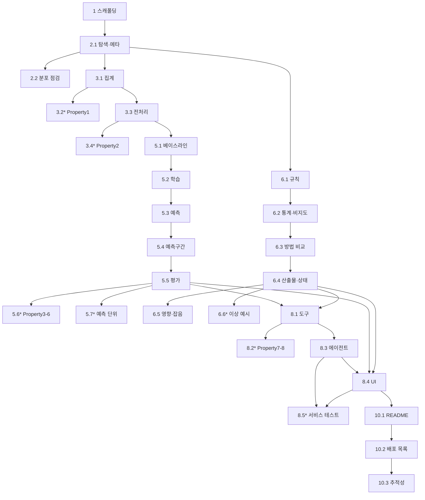

# Implementation Plan: Factory Energy Copilot

## Overview

본 문서는 Requirements-First 워크플로의 **Tasks 단계** 산출물이다. `requirements.md`(A1~A8, B1~B6, C1~C5, D1~D7, S1~S7, REQ-*, O-1~O-10)와 `design.md`(Components and Interfaces, Data Models, Correctness Property 1~8, Testing Strategy, 추적성 표)를 **근거로만** 사용하며 두 문서를 수정하지 않는다.

구현 언어는 **Python**이다(design.md Testing Strategy에서 Hypothesis 명시). 작업은 design.md "Tasks 단계" 지침의 8개 영역 순서(① 데이터 탐색 → ② 전처리/집계 → ③ 학습 → ④ 검증/평가 → ⑤ 이상탐지 → ⑥ 서비스화/에이전트 → ⑦ UI → ⑧ 문서화/운영)를 따르며, 맨 앞에 프로젝트 스캐폴딩을 둔다. 각 작업은 앞 작업의 승인된 산출물을 입력으로 삼아 점진적으로 쌓인다.

### 사실 라벨링 규약 (requirements.md·design.md와 동일)

- **[확인]**: 작업 1 사전 점검에서 검증된 사실.
- **[미확인]/[추정]**: 전수 미검증 또는 샘플 기반 추측.
- **[결정 필요]**: 사용자 승인 전 구현·평가 기준으로 확정하지 않는 항목(O-1~O-10).

### 공통 데이터·보안 규칙 (모든 데이터 처리 작업의 완료 조건에 포함)

- **대용량 금지(NFR-1, R1, R13):** `data/rtu_data_full_훈련용.csv`(4.9GB)를 전체 메모리에 적재하지 않는다. `Get-Content`/`Import-Csv`/pandas `read_csv` 전체 로드 금지. StreamReader 순차 또는 제한 청크만 사용하고 청크 크기·메모리·시간·오류를 로그에 남긴다.
- **원본 불변(NFR-2, R14):** 처리 전후 두 CSV의 `Length`·`LastWriteTime`(가능하면 해시)을 비교하고, 다르면 작업 실패·산출물 무효화. 산출물은 `artifacts/` 아래에만 저장하며 원본·중간 산출물을 덮어쓰지 않는다.
- **누수 방지(NFR-4, S2):** aggregate/preprocess/train/predict/anomaly 모듈은 `Validation_CSV` 경로를 참조하지 않는다. Evaluator만 예측 고정 후 정답을 읽는다.
- **artifacts-only(S7):** Dashboard·Agent는 `artifacts/`만 읽는다.
- **재현성(NFR-7):** 실행 시각, 코드·설정 버전, 입력 경로, 시간 기준(KST), 청크 설정, 난수 시드, 결과 경로, 요약 통계를 로그로 남긴다.
- **보안(NFR-6, R11, R16):** 키·토큰·비밀번호를 환경변수/시크릿에서만 읽고 값·부분값·환경 덤프를 코드·로그·문서·화면에 남기지 않는다.

### [결정 필요] 게이트 (O-1~O-10)

일부 항목은 사용자 승인으로 **결정 완료**되었다(아래 "상태"). 나머지 미결정 항목은 승인 전 해당 판정식·임계값·경계값·수치를 **구현·평가 기준으로 확정하지 않는다**.

| 게이트 | 내용 | 상태 | 연결 작업 |
|---|---|---|---|
| O-1 | PDF 3개 본문 미확인 → PDF 기인 범위·비목표 미확정 | 미결정 | 10.3 |
| O-2 | 이상 영향 정의·"잡음 범위" 판정 기준 | 미결정 | 6.5 |
| O-3 | 상태 정상/주의/이상 경계값·급증 정의 | 미결정 | 6.4 |
| O-4 | 독립 정답 라벨 출처·분리·평가 전용 | 미결정 | 6.3 |
| O-5 | 설비 수 **최대 13 상한 + 데이터에서 발견된 설비만 사용** | **결정됨**(2025 사용자 승인): 설비 수 13을 상한/기대값으로 두되 실제 집계에서 발견된 설비만 처리하고, 발견 수가 13과 다르면 경고·질문으로 남긴다 | 1.2, 6.4, 8.2 |
| O-6 | 첫 화면 5초 성능 목표 측정 환경·명령 | 미결정 | 8.4 |
| O-7 | 예측구간 분위수 값·검증 구간 정의 | **잠정 결정**(사용자 승인): 기본 분위수(예: 하한 0.05 / 상한 0.95)를 **잠정값**으로 사용하고 화면·로그에 "임시/잠정"으로 표시. 추후 확정 시 교체 | 5.4 |
| O-8 | Must/Should 우선순위 발주처 일치 | 미결정 | 10.3 |
| O-9 | B2 규칙 판정식 (a) 3상 동시 vs (b) 상별 | **결정됨**(사용자 승인): **(a) 3상 동시** — `(voltageR<210 AND voltageS<210 AND voltageT<210) OR (powerFactorR<85 AND powerFactorS<85 AND powerFactorT<85)` 채택 | 6.1 |
| O-10 | A7 MAE 73/89 임계값·보정 승인 | **결정됨**(사용자 승인): 73/89는 **참고용으로만 기록**하고 경고 임계값·합격/불합격 기준으로 사용하지 않는다. 정답 보정 금지 | 5.5, 5.7 |

---

## Tasks

- [ ] 1. 프로젝트 스캐폴딩과 설정 (TASK-SCAFFOLD)
  - 역할별 디렉터리와 단일 설정을 만들어 이후 모든 작업의 토대를 둔다.
  - 대상 파일/모듈: `src/aggregate/`, `src/preprocess/`, `src/train/`, `src/predict/`, `src/evaluate/`, `src/anomaly/`, `src/agent/`, `src/app/`, `src/common/`(공통 유틸·로깅), `artifacts/`(빈 폴더·`.gitkeep`), `config/config.py`, `requirements.txt`, `.gitignore`, `tests/`
  - 선행관계: 없음(최초 작업)
  - 산출물: 디렉터리 구조, `requirements.txt`(pandas, pyarrow/parquet, scikit-learn, streamlit, openai, hypothesis, pytest), `.gitignore`(`data/`·`.env`·`artifacts/*` 제외 규칙), `config/config.py`
  - 완료 조건: 8개 역할 모듈이 분리되어 존재하고, 환산 계수 `BILL_RATE=180`·`CARBON_RATE=0.424`가 **config 한 곳**에만 정의되며(NFR-8, R8), `OPENAI_API_KEY`·`OPENAI_MODEL`을 환경변수로만 읽는 로더가 있고 값을 로그에 남기지 않는다(NFR-6). `.gitignore`에 `data/`·`.env`가 포함된다(R1, R2). **역할 페르소나 enum**(`ROLES = {"facility": "설비 관리 담당자", "energy": "에너지 관리 담당자"}`)을 config에 단일 정의하고, 개인 이름 필드는 두지 않는다(REQ-USER, 팀장 피드백 "역할명으로만").
  - 검증 명령·테스트 전략: `python -c "import config.config as c; print(c.BILL_RATE, c.CARBON_RATE)"` → `180 0.424` 출력(성공 판정). `pip install -r requirements.txt` 성공. `.gitignore` grep으로 `data/`·`.env` 라인 존재 확인.
  - _Requirements: REQ-DATA, 1.6, 5.7 / NFR-6, NFR-8 / design: 저장소/파일 계약_

- [ ] 2. 데이터 탐색 (안전한 원본 이해)
  - [ ] 2.1 원본 메타데이터·스키마·불변 기준값 확인 모듈 (TASK-EXPLORE)
    - 두 CSV의 헤더·열 수·구분자·시작/끝 샘플·`Length`·`LastWriteTime`을 전체 적재 없이 확인하고 기록한다.
    - 대상 파일/모듈: `src/aggregate/explore.py`(읽기 전용 스캔), `src/common/io_meta.py`(메타·불변 비교 유틸)
    - 선행관계: 1
    - 산출물: `artifacts/source_meta.json`(파일별 Length·LastWriteTime·헤더·열 수·시작/끝 샘플 시각·물리 행 수)
    - 완료 조건: Training_CSV 19개 열·Validation_CSV 5개 열을 [확인]으로 기록하고, 전수 미검증 항목(연속성·설비 수·결측·중복)은 `[미확인]`으로 표시한다(REQ-DATA). StreamReader 제한 읽기만 사용하고 전체 로드 호출이 없다(NFR-1). 처리 전후 Length·LastWriteTime이 동일함을 로그에 남긴다(NFR-2).
    - 검증 명령·테스트 전략: `python -m src.aggregate.explore` 종료 코드 0 + `artifacts/source_meta.json` 생성 확인. 전후 메타 비교 로그에 "불변 확인" 기록.
    - _Requirements: REQ-DATA / NFR-1, NFR-2, NFR-7_
  - [ ] 2.2 설비 수·완전 시간 분포 스트리밍 점검 (TASK-EXPLORE-DIST)
    - 순차 스캔으로 발견된 설비 집합과 (module, hour)별 행 수 분포를 집계해 n=720 충족 여부 후보를 확인한다.
    - 대상 파일/모듈: `src/aggregate/explore.py`
    - 선행관계: 2.1
    - 산출물: `artifacts/explore_dist.json`(발견 설비 목록·수, n=720 충족/미충족 시간 수 요약)
    - 완료 조건: **설비 수는 최대 13 상한(O-5 결정)**을 기대값으로 두고 데이터에서 발견된 설비 집합을 그대로 기록하며, **발견 수가 13과 다르면 경고·질문으로 로그에 남긴다**. 전수 결과와 샘플 현상을 구분해 로그에 남긴다(NFR-7). 전체 적재 없이 단일 패스로 처리한다(NFR-1).
    - 검증 명령·테스트 전략: `python -m src.aggregate.explore --dist` 종료 코드 0 + `explore_dist.json`의 설비 목록·n 분포 필드 존재 확인.
    - _Requirements: 1.1, 4.3 / NFR-1, NFR-7 / O-5_

- [ ] 3. 전처리/집계 (hourly_from_full.parquet)
  - [ ] 3.1 시간·설비별 집계와 n=720 완전 시간 필터 (TASK-AGG)
    - 5초 원본을 제한 스트리밍으로 읽어 `hourly_pow = Σ(activePower × 5/3600)`를 시간·설비별로 집계하고 n=720 완전 시간만 남긴다.
    - 대상 파일/모듈: `src/aggregate/aggregate.py`
    - 선행관계: 2.1
    - 산출물: `artifacts/hourly_from_full.parquet`(필드 `module, hour(KST), hourly_pow, n` — design Data Models), 제외 건수 로그
    - 완료 조건: 시간 기준은 localtime(KST), timestamp 미사용(NFR-3). n=720만 학습 입력으로 남기고 n≠720 제외 건수를 로그에 기록(A1). 전체 적재 없이 순차/청크, 전후 원본 불변 확인(NFR-1, NFR-2). Validation_CSV 경로 미참조(NFR-4).
    - 검증 명령·테스트 전략: `python -m src.aggregate.aggregate` 종료 코드 0 + parquet 필드 스키마 검사. 제외 건수 로그 존재 확인.
    - _Requirements: 1.1 / NFR-1, NFR-2, NFR-3, NFR-4 / design: Property 1_
  - [ ]* 3.2 완전 시간 필터 속성 테스트 (TASK-AGG-PBT)
    - **Property 1: 완전 시간 필터 불변식** — n=720인 시간만 남고 제외 건수가 n≠720 시간 개수와 정확히 일치.
    - 대상 파일/모듈: `tests/test_property_aggregate.py`
    - 선행관계: 3.1
    - 산출물: Hypothesis 기반 property test
    - 완료 조건: 최소 100회 반복, 주석 태그 `Feature: factory-energy-copilot, Property 1: 완전 시간 필터 불변식`. Hypothesis를 직접 구현하지 않고 라이브러리 사용.
    - 검증 명령·테스트 전략: `pytest tests/test_property_aggregate.py -q` 전부 통과.
    - _Requirements: 1.1 / design: Property 1 (Validates 1.1)_
  - [ ] 3.3 공장 전체 전력량·달력 특성 생성 (TASK-PREP)
    - 집계 결과에서 설비 합산 공장 전체 시간별 전력량과 달력 특성(요일·시간대·주차 등)을 만들고 금지 특성을 차단한다.
    - 대상 파일/모듈: `src/preprocess/features.py`
    - 선행관계: 3.1
    - 산출물: `artifacts/features.parquet`(학습용 특성 테이블)
    - 완료 조건: 특성에 5월 미가용 전압·전류·역률과 4/30~5/10 lag를 **포함하지 않는다**(A3). 설비 합산 시 발견 설비 집합 사용(O-5 미확정). Validation_CSV 미참조(NFR-4). **전처리는 공용 유틸로 제공하되 다른 기능이 이 산출물에 의존하도록 강제하지 않는다** — 각 기능(학습·예측·이상탐지)은 필요에 맞게 전처리를 호출하고 자신의 전처리 근거·입력·변환을 로그/기능 설명에 남긴다(팀장 피드백 "필요한 내용에 맞게 전처리").
    - 검증 명령·테스트 전략: `python -m src.preprocess.features` 종료 코드 0 + 특성 목록에 금지 필드 부재를 단위 테스트로 확인.
    - _Requirements: 1.3 / NFR-4 / design: Property 2_
  - [ ]* 3.4 금지 특성 배제 속성 테스트 (TASK-PREP-PBT)
    - **Property 2: 금지 특성 배제 불변식** — 허용·금지 특성이 섞인 후보 집합에서 선택 결과에 금지 특성이 하나도 없음.
    - 대상 파일/모듈: `tests/test_property_features.py`
    - 선행관계: 3.3
    - 산출물: Hypothesis property test
    - 완료 조건: 최소 100회 반복, 주석 태그 `Feature: factory-energy-copilot, Property 2: 금지 특성 배제 불변식`.
    - 검증 명령·테스트 전략: `pytest tests/test_property_features.py -q` 통과.
    - _Requirements: 1.3 / design: Property 2 (Validates 1.3)_

- [ ] 4. 체크포인트 — 집계·전처리 산출물과 테스트 확인
  - 모든 테스트가 통과하는지 확인하고 의문이 있으면 사용자에게 질문한다.
  - _Requirements: 1.1, 1.3_

- [ ] 5. 학습·검증·평가
  - [ ] 5.1 베이스라인 3종 구현 (TASK-BASELINE)
    - 전체 평균 반복, 요일·시간대 과거 평균, 직전 주 같은 시간 값 세 베이스라인을 만든다.
    - 대상 파일/모듈: `src/train/baselines.py`
    - 선행관계: 3.3
    - 산출물: 세 베이스라인 예측 함수와 시간순 평가 MAE 입력
    - 완료 조건: 세 모델명과 계산 입력이 기록된다(A2). Validation_CSV 미참조(NFR-4).
    - 검증 명령·테스트 전략: `pytest tests/test_baselines.py -q`로 세 베이스라인 구조·출력 길이 확인(예시 테스트).
    - _Requirements: 1.2 / NFR-4_
  - [ ] 5.2 후보 모델 학습과 시간순 검증 선택 (TASK-TRAIN)
    - 달력 특성 선형회귀 → 트리 모델 1종을 학습하고 마지막 3주 시간순 검증 MAE로 선택 후 전체 재학습한다.
    - 대상 파일/모듈: `src/train/train.py`
    - 선행관계: 5.1
    - 산출물: 선택 모델·파라미터, `artifacts/model_selection.json`(분할 시각·선택 점수·재학습 시점·베이스라인+후보 비교표)
    - 완료 조건: 모델 선택에 **학습 구간 마지막 3주 시간순 검증 MAE만** 사용하고 5월 정답을 선택에 참조하지 않는다(A4). 확정 후 전체 기간 재학습(A4). 난수 시드·버전 로그(NFR-7). Validation_CSV 경로 미참조(NFR-4, S2).
    - 검증 명령·테스트 전략: `python -m src.train.train` 종료 코드 0 + `model_selection.json` 필드 검사. 정답 경로 미참조 정적/단위 테스트(5.9와 연계).
    - _Requirements: 1.2, 1.3, 1.4 / NFR-4, NFR-7_
  - [ ] 5.3 505개 시점 예측과 요금·탄소 환산 (TASK-PREDICT)
    - 확정 모델로 505개 시점을 예측하고 config 계수로 요금·탄소를 환산해 저장한다.
    - 대상 파일/모듈: `src/predict/predict.py`
    - 선행관계: 5.2
    - 산출물: `artifacts/predictions.csv`(`id, pred_pow, pred_bill, pred_carbon` — pred_low/high는 5.4에서 추가)
    - 완료 조건: id가 2025-05-10 00:00 ~ 2025-05-31 00:00 1시간 간격 505행, 중복·누락 없음(A5). `pred_bill = pred_pow × 180`, `pred_carbon = pred_pow × 0.424`를 단일 config에서 사용(NFR-8). Validation_CSV 미참조(NFR-4).
    - 검증 명령·테스트 전략: `python -m src.predict.predict` 종료 코드 0 + 행 수·id 격자 검사.
    - _Requirements: 1.5, 1.6 / NFR-8 / design: Property 3, Property 4_
  - [ ] 5.4 예측구간(pred_low/pred_high) 추가 (TASK-PREDICT-PI)
    - 검증 구간 잔차 분위수로 예측 상·하한을 만들어 predictions.csv에 추가한다.
    - 대상 파일/모듈: `src/predict/interval.py`
    - 선행관계: 5.3
    - 산출물: `predictions.csv`에 `pred_low, pred_high` 컬럼 추가, 분위수·검증 구간·계산식 로그
    - 완료 조건: 각 행에서 `pred_low ≤ pred_pow ≤ pred_high`(A8). **분위수는 O-7 잠정 결정** — 기본 분위수(하한 0.05 / 상한 0.95)를 **잠정값**으로 사용하고 로그·화면에 `임시/잠정`으로 표시한다. 분위수 값은 config의 단일 상수로 두어 추후 교체가 쉽도록 한다. 순서 불변식(하한≤예측≤상한)은 분위수와 무관하게 항상 보장한다.
    - 검증 명령·테스트 전략: `python -m src.predict.interval` 종료 코드 0 + 모든 행 순서 조건 검사.
    - _Requirements: 1.8 / design: Property 6 / O-7_
  - [ ] 5.5 평가와 evaluation.json 생성 (TASK-EVAL)
    - 예측 고정 후 Validation_CSV를 읽어 504/505 MAE·총합오차·비교표를 계산한다.
    - 대상 파일/모듈: `src/evaluate/evaluate.py`
    - 선행관계: 5.4
    - 산출물: `artifacts/evaluation.json`(`mae_hourly_pow`, `mae_may_bill`, `mae_may_carbon` 각 504/505 기준, `agg_pow_total_error`, `baseline_comparison`, `reference_note`)
    - 완료 조건: 예측이 **고정(생성 완료)된 뒤에만** 정답을 읽는다(A4, A6). MAE는 504 기준(마지막 2025-05-31 00:00 제외)과 505 기준 둘 다(R7). **A7의 73/89는 O-10 결정에 따라 참고용으로만 기록**하고(경고 임계값·합격/불합격 기준으로 사용 금지), `reference_note`에 `참고용(합격 기준 아님)`으로 표시한다. 정답으로 예측을 보정하는 코드가 없다(A7, R5).
    - 검증 명령·테스트 전략: `python -m src.evaluate.evaluate` 종료 코드 0 + JSON 필드·504/505 수치 존재 검사.
    - _Requirements: 1.6, 1.7 / design: Property 5 / O-10_
  - [ ]* 5.6 예측 구조·환산·MAE·구간 속성 테스트 (TASK-EVAL-PBT)
    - **Property 3: 예측 산출물 구조 불변식**(505·id 1:1), **Property 4: 요금·탄소 선형 환산 불변식**, **Property 5: MAE 정의 일치 불변식**, **Property 6: 예측구간 순서 불변식**을 각각 별도 property test로 구현.
    - 대상 파일/모듈: `tests/test_property_predict.py`, `tests/test_property_eval.py`
    - 선행관계: 5.5
    - 산출물: Hypothesis property tests (속성당 하나)
    - 완료 조건: 각 속성 최소 100회 반복, 주석 태그 `Feature: factory-energy-copilot, Property 3: 예측 산출물 구조 불변식` / `... Property 4: 요금·탄소 선형 환산 불변식` / `... Property 5: MAE 정의 일치 불변식` / `... Property 6: 예측구간 순서 불변식`.
    - 검증 명령·테스트 전략: `pytest tests/test_property_predict.py tests/test_property_eval.py -q` 통과.
    - _Requirements: 1.5, 1.6, 1.8, 5.1 / design: Property 3·4·5·6_
  - [ ]* 5.7 예측·평가 단위/경계 테스트 (TASK-EVAL-UNIT)
    - 프롬프트 3 pytest 항목 중 예측·학습·평가 관련 항목을 예시/단위 테스트로 구현.
    - 대상 파일/모듈: `tests/test_predictions_shape.py`, `tests/test_no_leak.py`, `tests/test_conversion.py`, `tests/test_mae_threshold_policy.py`
    - 선행관계: 5.5
    - 산출물: 예시·경계 테스트
    - 완료 조건: (1) predictions.csv 505행·id 2025-05-10 00:00~2025-05-31 00:00 1시간 간격 검사, (2) train/predict 모듈이 정답 파일 경로를 참조하지 않음(정적 문자열/임포트 검사, S2·NFR-4), (3) `pred_bill = pred_pow × 180`·`pred_carbon = pred_pow × 0.424` 검사, (4) **A7 73/89는 O-10 승인 전 경고/합격 판정 테스트로 만들지 않고** "임계값 미사용·정답 보정 코드 부재"를 검사하는 테스트로 둔다.
    - 검증 명령·테스트 전략: `pytest tests/test_predictions_shape.py tests/test_no_leak.py tests/test_conversion.py tests/test_mae_threshold_policy.py -q` 통과.
    - _Requirements: 1.5, 5.1, 5.2, 1.6 / O-10_

- [ ] 6. 이상 탐지
  - [ ] 6.1 5초 행 규칙 후보 탐지 (TASK-ANOM-RULE)
    - 5초 행 단위로 전압·역률 규칙 후보를 추출한다. 판정식은 승인 전 미확정.
    - 대상 파일/모듈: `src/anomaly/rules.py`
    - 선행관계: 2.1
    - 산출물: 규칙 후보 결과(이벤트 후보 집합) — (a) 3상 동시 판정식 채택, F5 매핑 근거 기록
    - 완료 조건: 탐지 단위는 module/localtime 5초 행(B1). **B2 판정식은 O-9 결정에 따라 (a) 3상 동시**를 채택한다: `(voltageR<210 AND voltageS<210 AND voltageT<210) OR (powerFactorR<85 AND powerFactorS<85 AND powerFactorT<85)`. 임계값(210V, 85%)은 config 단일 상수로 둔다. 전체 적재 없이 순차/청크(NFR-1), 원본 불변(NFR-2), Validation_CSV 미참조(NFR-4).
    - 검증 명령·테스트 전략: `python -m src.anomaly.rules --dry-run` 종료 코드 0 + 3상 동시 규칙 적용·임계값 config 참조 로그 확인.
    - _Requirements: 2.1, 2.2 / NFR-1, NFR-2, NFR-4 / O-9(결정: 3상 동시)_
  - [ ] 6.2 통계·비지도 탐지와 방법 매칭 (TASK-ANOM-ML)
    - 설비별 3σ/robust z-score와 Isolation Forest(표본 학습 후 청크 점수화)를 적용하고 세 방법 결과를 같은 5초 행에 매칭한다.
    - 대상 파일/모듈: `src/anomaly/detectors.py`
    - 선행관계: 6.1
    - 산출물: 방법별 점수·탐지 여부가 매칭된 이벤트 테이블(중간)
    - 완료 조건: 비지도는 표본 학습 후 청크 점수화로 전체 적재 금지(B2, NFR-1). 후보 특성(3상 전압/역률/전류 평균, activePower, `activePower/Σ(V×I×PF/100)` 비율) 사용. 표본·청크·시드 로그(NFR-7).
    - 검증 명령·테스트 전략: `python -m src.anomaly.detectors --sample` 종료 코드 0 + 세 방법 점수 컬럼 존재 확인.
    - _Requirements: 2.2 / NFR-1, NFR-7_
  - [ ] 6.3 방법 비교·프록시 지표 산출 (TASK-ANOM-COMPARE)
    - 방법별 탐지 건수와 겹침을 표로 만들고 규칙 기준 계산값을 프록시로 명명한다.
    - 대상 파일/모듈: `src/anomaly/compare.py`
    - 선행관계: 6.2
    - 산출물: 방법 비교표(건수·겹침·`규칙 대비 일치율`/`규칙 포착률` 분모·대상 기간·한계)
    - 완료 조건: **독립 정답 라벨이 없는 동안 규칙 결과를 정답으로 부르지 않는다**(B3). 프록시 명명·분모·한계 표시. **O-4 독립 라벨은 [결정 필요]** — 선행 "승인 확인" 게이트에서 미승인 시 독립 정답 지표를 생성하지 않는다.
    - 검증 명령·테스트 전략: `python -m src.anomaly.compare` 종료 코드 0 + 비교표 프록시 명명·분모·한계 필드 검사(예시 테스트).
    - _Requirements: 2.3, 5.4 / O-4_
  - [ ] 6.4 이상 산출물·설비 상태 생성 (TASK-ANOM-ARTIFACTS)
    - 세 이상 산출물과 설비 상태표를 저장한다. 상태 경계값은 승인 전 미확정.
    - 대상 파일/모듈: `src/anomaly/artifacts.py`
    - 선행관계: 6.3
    - 산출물: `artifacts/anomaly_events.parquet`(module, localtime, type, value, normal_range, detected_by, score), `artifacts/anomaly_hourly.parquet`(hour, module, type, count), `artifacts/module_status.csv`(module, anomaly_count, anomaly_ratio, last_seen, status)
    - 완료 조건: 세 파일 필드·경로가 design Data Models와 일치(B4). 상태는 설비별 이상 행 비율·급증 여부 기반(B5). **O-3 경계값·급증 정의 [결정 필요]** — 미승인 시 status를 `미확정` 라벨로 표시. **설비 집합은 최대 13 상한(O-5 결정) 안에서 발견된 설비만 사용하고, 발견 수가 13과 다르면 경고로 기록**. 원본 미덮어쓰기(NFR-2).
    - 검증 명령·테스트 전략: `python -m src.anomaly.artifacts` 종료 코드 0 + 세 산출물 스키마 검사(예시 테스트).
    - _Requirements: 2.4, 2.5 / NFR-2 / O-3, O-5_
  - [ ] 6.5 이상 영향·잡음 판정 (TASK-ANOM-IMPACT)
    - 이상 구간의 전력량·요금 영향을 측정 가능한 경우에만 계산한다.
    - 대상 파일/모듈: `src/anomaly/impact.py`
    - 선행관계: 6.4
    - 산출물: 영향 계산 입력·비교 범위 로그, 측정 불가/잡음 판정 기록
    - 완료 조건: 측정된 경우에만 숫자 표시, 잡음 범위면 `영향 없음(잡음 범위)` 기록, 미측정 값을 숫자로 표시하지 않는다(B6). **O-2 영향 정의·잡음 기준 [결정 필요]** — 선행 "승인 확인" 게이트에서 미승인 시 영향 수치를 확정 지표로 쓰지 않는다.
    - 검증 명령·테스트 전략: `python -m src.anomaly.impact` 종료 코드 0 + 미측정→숫자 미표시 단위 테스트.
    - _Requirements: 2.6 / O-2_
  - [ ]* 6.6 이상탐지 예시·경계 테스트 (TASK-ANOM-UNIT)
    - 이벤트 키·산출물 스키마·프록시 명명을 예시 테스트로 고정. (B2·B5·B6 판정식은 O-9/O-3/O-2 승인 후 속성화 — 이 단계에서는 미작성.)
    - 대상 파일/모듈: `tests/test_anomaly_schema.py`
    - 선행관계: 6.4
    - 산출물: 예시 테스트
    - 완료 조건: anomaly_events/hourly·module_status 필드 존재, 이벤트 키 module/localtime, 프록시 명명·분모·한계 검사. 승인 대기 판정식은 테스트 대상에서 제외하고 주석으로 "O-9/O-3/O-2 승인 후 속성화" 표시.
    - 검증 명령·테스트 전략: `pytest tests/test_anomaly_schema.py -q` 통과.
    - _Requirements: 2.1, 2.3, 2.4 / O-2, O-3, O-9_

- [ ] 7. 체크포인트 — 예측·평가·이상탐지 산출물 확인
  - 모든 테스트가 통과하는지 확인하고 의문이 있으면 사용자에게 질문한다.
  - _Requirements: 1.5, 1.6, 2.4_

- [ ] 8. 서비스화·에이전트·UI
  - [ ] 8.1 artifacts-only 도구 함수 (TASK-TOOLS)
    - artifacts만 읽는 Python 도구 함수 5종을 구현하고 경로 밖 접근을 거부한다.
    - 대상 파일/모듈: `src/agent/tools.py`
    - 선행관계: 5.5, 6.4
    - 산출물: `get_forecast_summary(start, end)`, `get_evaluation()`, `get_module_status()`, `get_anomaly_events(module, start, end, type)`, `get_anomaly_trend(module, freq)` + 입력/출력 스키마·오류 응답 문서
    - 완료 조건: 각 함수가 `artifacts/` 루트 밖(원본 CSV 포함) 경로를 거부한다(C1). 숫자는 artifacts에서만 가져온다(C2, R10).
    - 검증 명령·테스트 전략: `pytest tests/test_tools_schema.py -q`로 스키마·오류 응답 확인.
    - _Requirements: 3.1, 3.2 / design: Property 7_
  - [ ]* 8.2 경로 보안·재현성 속성 테스트 (TASK-TOOLS-PBT)
    - **Property 7: artifacts-only 경로 보안 불변식**, **Property 8: 재현성(결정성) 불변식**을 각각 property test로 구현.
    - 대상 파일/모듈: `tests/test_property_tools.py`, `tests/test_property_repro.py`
    - 선행관계: 8.1
    - 산출물: Hypothesis property tests
    - 완료 조건: 각 속성 최소 100회 반복, 주석 태그 `Feature: factory-energy-copilot, Property 7: artifacts-only 경로 보안 불변식` / `... Property 8: 재현성(결정성) 불변식`.
    - 검증 명령·테스트 전략: `pytest tests/test_property_tools.py tests/test_property_repro.py -q` 통과.
    - _Requirements: 3.1, 1.6 / design: Property 7·8_
  - [ ] 8.3 function calling 에이전트·fallback·캐시 (TASK-AGENT)
    - OpenAI function calling으로 도구를 호출하고 키 없음·실패 시 규칙 기반으로 대체한다.
    - 대상 파일/모듈: `src/agent/agent.py`
    - 선행관계: 8.1
    - 산출물: 에이전트 호출 계층, 브리핑·대상별 전환·질의응답, 응답 캐시
    - 완료 조건: 결과에 없는 내용은 `데이터에 없음`(C2). 브리핑·경영진 5줄/에너지 관리자/현장 담당자 전환(C3). `고장`·`위험 확정` 단정 금지, 관찰 사실/원인 후보/현장 확인 세 구획(C4, R9). `OPENAI_API_KEY` 없음·호출 실패 시 예외 없이 규칙 기반 fallback·캐시(C5). 키·모델명 환경변수에서만 읽음(NFR-6).
    - 검증 명령·테스트 전략: `pytest tests/test_agent_fallback.py -q`로 키 없음·실패 fallback·금지 표현 검사.
    - _Requirements: 3.2, 3.3, 3.4, 3.5 / NFR-6_
  - [ ] 8.4 Streamlit 대시보드 (TASK-UI)
    - artifacts만 읽는 탭·필터·상태색·필수 시각화·경고를 구현한다.
    - 대상 파일/모듈: `src/app/app.py`
    - 선행관계: 5.5, 6.4, 8.3
    - 산출물: 헤더(팀명/제목/설명/기준 기간), 예측 탭(그래프·MAE 카드·베이스라인 비교표·총합·계산식), 이상 탭(상태표 색·이벤트 표·전압/역률 시계열·세 방법 비교표), AI 탭(브리핑·대상 전환·질의·계산/AI 구분), 사이드바(날짜·설비 필터 + **역할명 전환 셀렉터**), 경고(예측구간 이탈·급증), 역할 기반 맞춤 화면 틀(`role` enum으로 분기)
    - 완료 조건: artifacts만 읽고 원본 미접근(S7). 필수 4요소 포함(D1·D2·D3·D4, S6). **설비 수는 최대 13 상한(O-5 결정) 안에서 발견 설비를 표시**하고, 발견 수가 13과 다르면 화면에 안내를 둔다. **예측구간 분위수는 O-7 잠정값**이라 화면에 "임시/잠정"으로 표시한다. **첫 화면 5초 성능은 O-6 미승인 시 측정값만 기록하고 합격/실패 판정하지 않는다**(D7, 선행 "승인 확인" 게이트). **역할 페르소나는 역할명(설비 관리 담당자/에너지 관리 담당자)으로만 표시하고 개인 이름을 쓰지 않는다**(REQ-USER). 역할 전환은 config의 `role` enum만을 분기 기준으로 사용한다.
    - 검증 명령·테스트 전략: `pytest tests/test_ui_elements.py -q`로 필수 요소·상태색·필터·경고·계산식 존재(UI/스냅샷 검증). 앱은 사용자가 수동으로 `streamlit run src/app/app.py` 실행(자동 실행 금지).
    - _Requirements: 4.1, 4.2, 4.3, 4.4, 4.5, 4.6, 4.7, 5.3, 5.6, 5.7 / O-5, O-6_
  - [ ]* 8.5 서비스 통합·장애 주입 테스트 (TASK-SERVICE-UNIT)
    - 프롬프트 3 pytest 항목 중 에이전트·앱 항목을 예시/장애 테스트로 구현.
    - 대상 파일/모듈: `tests/test_artifacts_only.py`, `tests/test_app_no_key.py`
    - 선행관계: 8.3, 8.4
    - 산출물: 장애 주입·경계 테스트
    - 완료 조건: (1) 에이전트 도구가 artifacts 밖 파일을 읽지 않음(C1, Property 7 상보), (2) `OPENAI_API_KEY`가 없을 때 앱이 예외 없이 뜸(C5), (3) 원본 미존재 artifacts-only 실행 성공(S7).
    - 검증 명령·테스트 전략: `pytest tests/test_artifacts_only.py tests/test_app_no_key.py -q` 통과.
    - _Requirements: 3.1, 3.5, 5.7_

- [ ] 9. 체크포인트 — 서비스·UI·테스트 확인
  - 모든 테스트가 통과하는지 확인하고 의문이 있으면 사용자에게 질문한다.
  - _Requirements: 3.1, 4.1, 5.7_

- [ ] 10. 문서화·운영
  - [ ] 10.1 README·환경변수·재현 명령 (TASK-README)
    - 실행 순서, 필요한 환경변수, 재현 명령을 문서화한다.
    - 대상 파일/모듈: `README.md`, `.env.example`
    - 선행관계: 8.4
    - 산출물: README(집계→학습→예측→평가→이상탐지→에이전트→UI 실행 순서, `OPENAI_API_KEY`/`OPENAI_MODEL` 설명, 재현 명령·시드, **팀 협업·진행 공유 방식: 진행 상황·문의는 GitHub(이슈/PR)와 팀 톡방으로 공유**), `.env.example`(값 없이 키 이름만)
    - 완료 조건: 키 값·부분값을 문서에 남기지 않는다(NFR-6). 재현에 필요한 입력 경로·KST·청크·시드 명시(NFR-7). 협업 공유 방식(GitHub·톡방) 섹션이 README에 존재한다(팀장 피드백).
    - 검증 명령·테스트 전략: README에 8단계 실행 순서·환경변수 섹션 존재 확인(문서 리뷰).
    - _Requirements: NFR-6, NFR-7_
  - [ ] 10.2 배포 목록·data/.env 제외 확인 (TASK-DEPLOY-LIST)
    - 배포 대상 파일 목록을 작성하고 원본·비밀 제외를 확인한다.
    - 대상 파일/모듈: `README.md`(배포 섹션), `.gitignore`
    - 선행관계: 10.1
    - 산출물: 배포 목록(artifacts, 앱 코드, requirements.txt)
    - 완료 조건: 배포 대상에 `data/`·`.env`가 포함되지 않음을 확인·기록(R1, R2, S7).
    - 검증 명령·테스트 전략: `.gitignore` grep + 배포 목록에 `data/`·`.env` 부재 확인(문서 리뷰).
    - _Requirements: 5.7 / NFR-6_
  - [ ] 10.3 추적성·미결정 사항 정리 (TASK-TRACE)
    - 요구사항↔작업 추적성과 O-1~O-10 미결정 상태를 문서에 정리한다.
    - 대상 파일/모듈: `README.md`(추적성·미결정 섹션)
    - 선행관계: 10.2
    - 산출물: 추적성 요약, 미결정(O-1~O-10) 질문·결정 주체·결정 전 허용 동작
    - 완료 조건: 연결되지 않은 요구사항이 없음을 종료 점검(아래 추적성 표). **O-1(PDF 범위·비목표), O-8(Must/Should 우선순위)**는 PDF 원문 확인·사용자 승인 전 확정하지 않음을 명시.
    - 검증 명령·테스트 전략: 추적성 표 상호 참조 확인(문서 리뷰).
    - _Requirements: REQ-OPEN, REQ-RISK / O-1, O-8_

- [ ] 11. 최종 체크포인트 — 전체 테스트 통과 확인
  - 모든 property test(1~8, 각 100회 이상)와 예시/단위/장애 테스트가 통과하는지 확인하고, 미결정(O-*) 항목이 승인 전 확정되지 않았는지 점검한다. 의문이 있으면 사용자에게 질문한다.
  - _Requirements: 5.1, 5.2, 5.5, 5.7_

## Notes

- `*` 표시 하위 작업(테스트)은 선택이며 빠른 MVP에서 건너뛸 수 있다. 상위 작업과 비테스트 하위 작업은 반드시 구현한다.
- Correctness Property 1~8은 각각 **단일** Hypothesis property test로 구현하며 최소 100회 반복, 주석 태그 `Feature: factory-energy-copilot, Property N: ...`를 단다.
- A7의 MAE 73/89는 **O-10 승인 전 경고/합격 판정에 사용하지 않는다**. 승인 전에는 "임계값 미사용·정답 보정 코드 부재"만 검사한다(5.7).
- B2 판정식(O-9), 상태 경계(O-3), 영향 정의(O-2)는 **승인 후 속성화** 대상이며 승인 전 구현·평가 기준으로 확정하지 않는다.
- 모든 데이터 처리 작업은 4.9GB 전체 적재 금지, 원본 불변 전후 비교, 훈련/검증 누수 방지, artifacts-only 서비스, 재현성 로그, 비밀 미기록을 지킨다.
- 애플리케이션(Streamlit)은 자동 실행하지 않고 사용자가 수동으로 `streamlit run src/app/app.py`를 실행한다.

## Task Dependency Graph

작업 선행관계. 같은 wave의 작업은 병렬 가능하고, wave N은 wave 0..N-1 완료 후 실행한다. 체크포인트·상위 부모 작업은 그래프에서 제외한다.



```json
{
  "waves": [
    { "id": 0, "tasks": ["1.1"] },
    { "id": 1, "tasks": ["2.1"] },
    { "id": 2, "tasks": ["2.2", "3.1", "6.1"] },
    { "id": 3, "tasks": ["3.2", "3.3", "6.2"] },
    { "id": 4, "tasks": ["3.4", "5.1", "6.3"] },
    { "id": 5, "tasks": ["5.2", "6.4"] },
    { "id": 6, "tasks": ["5.3", "6.5", "6.6", "8.1"] },
    { "id": 7, "tasks": ["5.4", "8.2", "8.3"] },
    { "id": 8, "tasks": ["5.5", "8.4"] },
    { "id": 9, "tasks": ["5.6", "5.7", "8.5", "10.1"] },
    { "id": 10, "tasks": ["10.2"] },
    { "id": 11, "tasks": ["10.3"] }
  ]
}
```

## 추적성 표 (요구사항 ID → 작업 ID)

| 요구사항 ID | acceptance | 작업 ID | 검증 전략 |
|---|---|---|---|
| REQ-PROB/GOAL/USER/SCOPE/SCENARIO | 문서 정의·연결 | 10.3 | 문서 리뷰·추적성 |
| REQ-NONSCOPE | 비목표 6개, PDF는 O-1 | 10.3 | 문서 리뷰 / O-1 |
| REQ-DATA | 경로·필드·읽기전용 | 1.1, 2.1 | 메타·스키마 검사 |
| REQ-NFR (NFR-1~8) | 대용량·불변·누수·보안·재현 | 2.1, 3.1, 5.2, 6.1, 8.3, 10.1 | 로그·정적·장애 테스트 |
| REQ-RISK | 위험 8개 완화 | 전 작업 완료 조건, 10.3 | 문서 리뷰 |
| REQ-OPEN (O-1~O-10) | 승인 전 미확정 | 5.4, 5.5, 5.7, 6.1, 6.3, 6.4, 6.5, 8.4, 10.3 | 게이트·미승인 표시 |
| A1 (1.1) | n=720 필터·제외 건수 | 3.1 | Property 1 (3.2) |
| A2 (1.2) | 베이스라인 3종 비교표 | 5.1 | 예시 테스트 |
| A3 (1.3) | 금지 특성 배제 | 3.3 | Property 2 (3.4) |
| A4 (1.4) | 시간순 검증·재학습 | 5.2 | 로그·경로 테스트 |
| A5 (1.5) | 505행·id 1:1 | 5.3 | Property 3 (5.6), 5.7 |
| A6 (1.6) | 504/505 MAE·총합·비교표 | 5.5 | Property 4·5 (5.6) |
| A7 (1.7) | 73/89 미사용·보정 부재 | 5.5, 5.7 | 정책 테스트 / O-10 |
| A8 (1.8) | 하한≤예측≤상한 | 5.4 | Property 6 (5.6) / O-7 |
| B1 (2.1) | 5초 행 단위 | 6.1 | 예시 (6.6) |
| B2 (2.2) | 세 방법·판정식 승인 전 | 6.1, 6.2 | 승인 후 속성화 / O-9 |
| B3 (2.3) | 프록시 명명·독립 라벨 | 6.3 | 예시 (6.6) / O-4 |
| B4 (2.4) | 세 산출물 스키마 | 6.4 | 스키마 테스트 (6.6) |
| B5 (2.5) | 상태 경계·급증 | 6.4 | 승인 후 속성화 / O-3 |
| B6 (2.6) | 영향·잡음 판정 | 6.5 | 단위 테스트 / O-2 |
| C1 (3.1) | 함수 스키마·artifacts-only | 8.1 | Property 7 (8.2), 8.5 |
| C2 (3.2) | 숫자 출처·데이터 없음 | 8.3 | 예시 (8.5) |
| C3 (3.3) | 브리핑·대상 전환 | 8.3 | 예시 |
| C4 (3.4) | 단정 금지·세 구획 | 8.3 | 금지 표현 테스트 (8.3) |
| C5 (3.5) | 키 없음·실패 fallback | 8.3 | 장애 주입 (8.5) |
| D1~D4 (4.1~4.4) | 헤더·예측·이상·AI 탭 | 8.4 | UI 검증 (8.4) |
| D5 (4.5) | 날짜·설비 필터 | 8.4 | UI 검증 |
| D6 (4.6) | 예측구간 이탈·급증 경고 | 8.4 | UI 검증 |
| D7 (4.7) | 5초 성능 미승인 미판정 | 8.4 | 측정 로그 / O-6 |
| S1 (5.1) | 505행·id 일치 | 5.3 | Property 3 (5.6), 5.7 |
| S2 (5.2) | 정답 경로 미참조 | 5.2 | 경로 테스트 (5.7) |
| S3 (5.3) | MAE·비교표 UI | 8.4 | UI 검증 |
| S4 (5.4) | 프록시 수치 제시 | 6.3 | 예시 (6.6) |
| S5 (5.5) | 답변↔artifacts 일치 | 8.1, 8.3 | 예시 (8.5) |
| S6 (5.6) | 필수 4요소 | 8.4 | UI 검증 / O-1 |
| S7 (5.7) | artifacts-only 실행 | 8.4 | 장애 주입 (8.5) |
| Property 1~8 | design Correctness Properties | 3.2, 3.4, 5.6, 8.2 | Hypothesis ≥100회 |

**추적성 종료 점검:** A1~A8, B1~B6, C1~C5, D1~D7, S1~S7, REQ-*, O-1~O-10, Property 1~8이 각각 한 개 이상의 작업과 연결되었다. 연결되지 않은 요구사항은 없다.

## 단계 보고 (Tasks)

- **생성 경로:** `./.kiro/specs/factory-energy-copilot/tasks.md`
- **수정 경로:** 없음(requirements.md·design.md·원본 CSV·PDF 미수정).
- **근거:** requirements.md(A/B/C/D, S1~S7, REQ-*, O-1~O-10), design.md(Components and Interfaces, Data Models, Property 1~8, Testing Strategy, 추적성 표), kiro_prompt_factory_energy_copilot.md의 프롬프트 2 "Tasks 단계" 8개 영역·프롬프트 3 구현 순서·pytest 항목.
- **검증 명령과 결과:**
  - `list_directory`로 스펙 디렉터리 확인 — 종료 코드 없음(툴 호출). 판정 근거: `.config.kiro`·`requirements.md`·`design.md` 존재, `tasks.md` 빈 상태 확인. 성공.
  - 분석·학습·테스트 명령은 이 단계에서 실행하지 않음 → **미검증**(구현 승인 후 수행).
- **원본 불변:** 이 단계에서 두 CSV·PDF를 읽거나 수정하지 않았다. 재측정하지 않았으므로 재측정 결과는 **[미검증]**.
- **Git:** 이 환경의 Git 작업 트리 여부를 재확인하지 않았다. 저장소가 없으면 `git init`·커밋을 하지 않는다 → Git 증거 **[미검증]**.
- **남은 위험·질문:** O-1~O-10 미해소. 특히 O-9(B2 판정식), O-10(A7 임계값), O-3(상태 경계), O-2(영향 정의), O-5(설비 수), O-6(5초 성능), O-7(예측구간 분위수), O-4(독립 라벨), O-1(PDF 범위), O-8(우선순위)는 사용자 승인 전 구현·평가 기준으로 확정하지 않는다.

## 다음 단계

이 문서는 Tasks 단계 산출물이다. **사용자 최종 승인을 받은 뒤에만** 구현을 시작한다. 승인 전에는 애플리케이션·분석·학습·테스트 코드와 분석 산출물을 작성하거나 실행하지 않는다. 승인 후에는 `tasks.md`를 열어 작업 항목 옆의 "Start task"로 실행을 시작할 수 있다.
